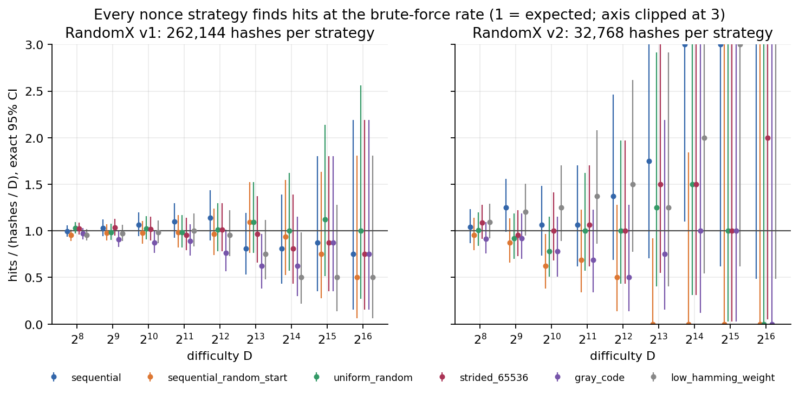
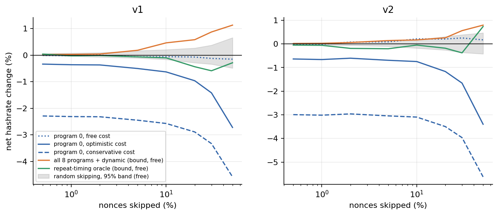
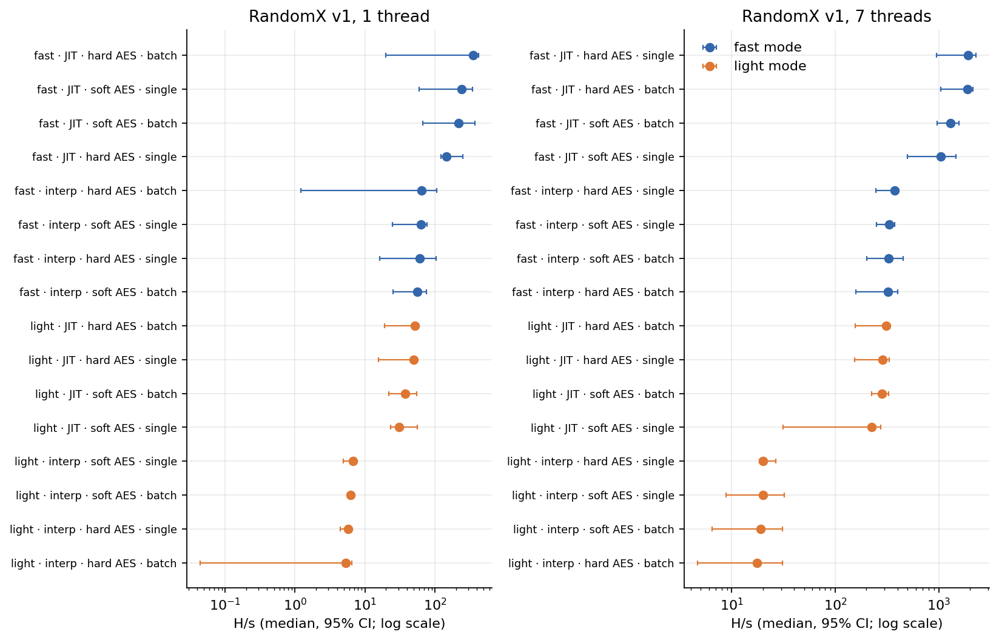
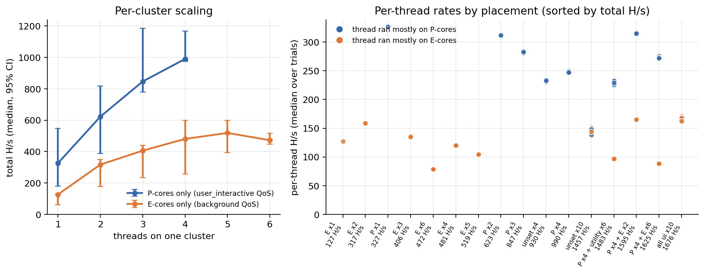
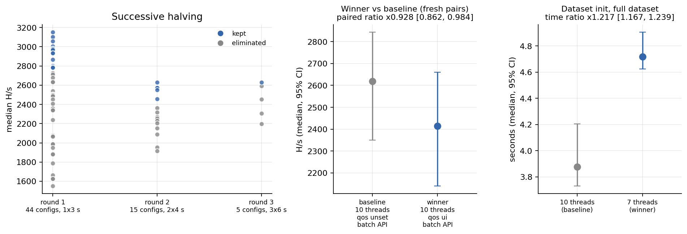
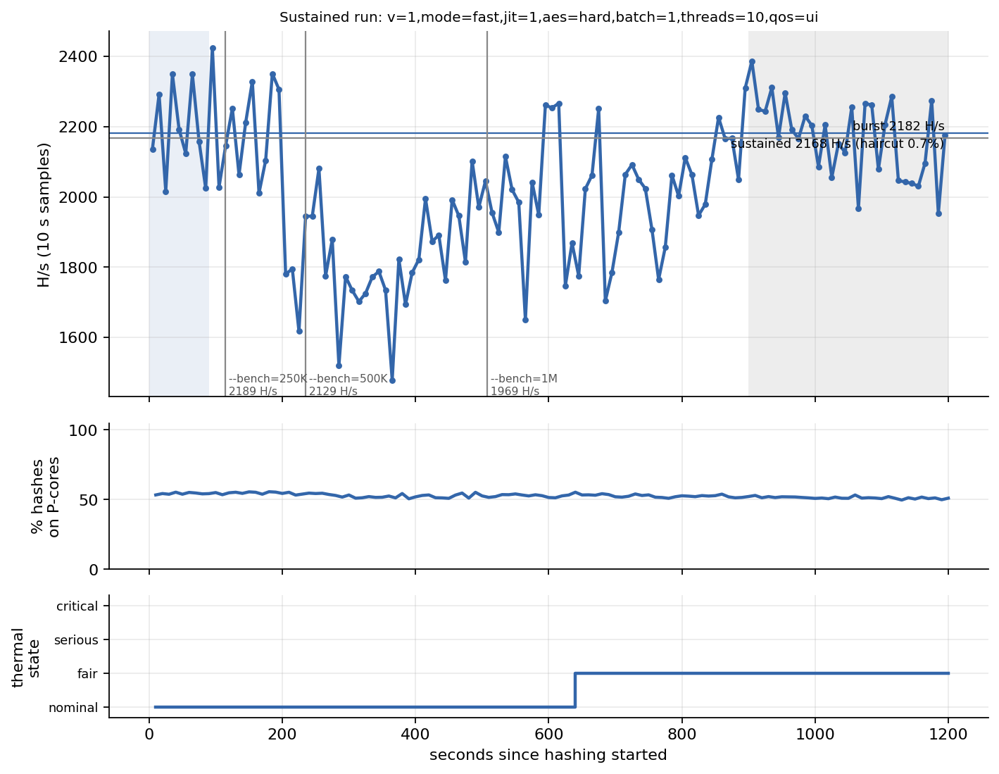
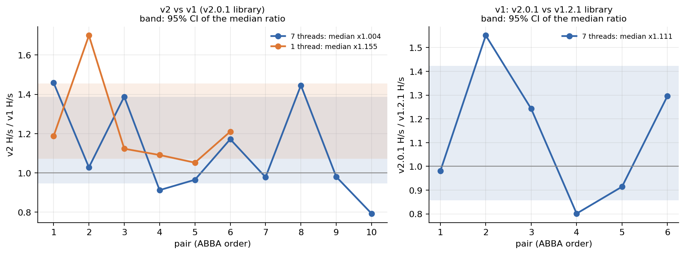
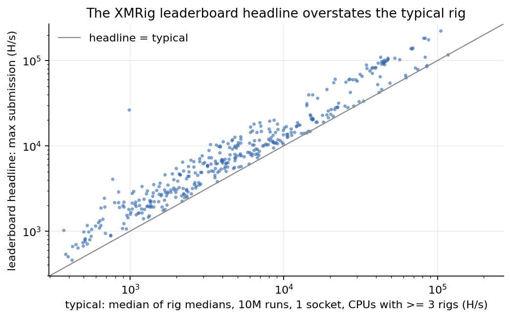
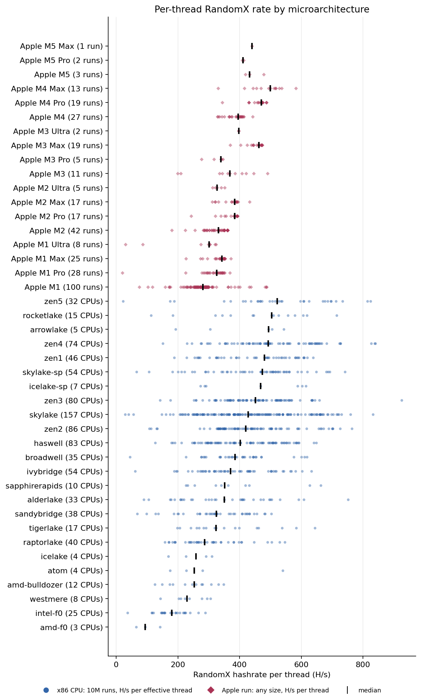

# Findings

**Question.** Is there a better way to solve RandomX, Monero's proof-of-work, on a CPU?

This page brings together every result in `results/`. Methods are in `docs/`. Each number here is taken from a result file, a doc, the code, or one of the upstream observations in section 8. All timings come from one loaded machine (section 2); read absolute H/s as depressed, noisy figures.

## 1. Short answer

- **No tested shortcut beats brute force.** The repo computed 1,853,952 real RandomX hashes under six nonce orders. Every order finds difficulty-meeting hashes at a rate consistent with brute force. A battery of 376 statistical tests finds no structure in the output (smallest Holm-adjusted p = 0.93), and the wait for the next hit shows no memory. These tests run at difficulties 2^1 to 2^16 and bound only effects above their resolution (section 3.1); they do not prove that no shortcut exists.
- **Skipping expensive nonces loses hashrate in this data.** A miner could try to predict each nonce's hash cost from program 0 and skip the slow ones. Once the scratchpad fill that exposes program 0 is paid for, the best skip rule costs 0.25–3.0% of hashrate. Per-nonce timing did not repeat under the load at which this was measured, so the sign rests on cost accounting and an uncalibrated model bound (section 3.2).
- **The program-structure survey found nothing to exploit.** Work per hash is constant to 0.016%. Adjacent programs' modelled compute correlates at r ≈ 0.002, no program repeats, and a GPU-style warp sees about 16 different instruction types in each slot.
- **Speed comes from implementation and hardware.** On this M4, with 7 threads, from 3 trials per configuration (unpaired, loaded machine):
  - fast mode (the 2,080 MiB dataset) over light mode: about 6.2× [3.2, 13.7];
  - the JIT over the interpreter: about 5.9× [2.6, 13.4];
  - hardware AES over software AES: 1.47× [0.67, 2.20], not resolved;
  - the batch API: no detectable effect.

  Across x86 CPUs in the public XMRig database, a model of microarchitecture × min(threads, L3 / 2 MiB) fits log hashrate well (out-of-fold R² 0.968 on the 392 CPUs with at least 3 rigs), but most of that comes from thread count alone (0.942); it explains 0.447 of the log per-thread rate. Within one CPU model, rigs reporting huge pages hash 53% faster than rigs without; this is an observational association in self-submitted results, not a controlled test. RandomX v2 hashed 1.15× [1.07, 1.45] faster than v1 on one thread on the P-cores (6 of 6 pairs, n = 6). An estimated tenth to half of that gain (point estimate about a quarter) comes from v2's CFROUND filter.
- **Measured throughput.** This machine, on battery and with an unrelated workload running, sustained 2,168 H/s at 10 threads over 20 minutes, 0.65% below its burst rate, a difference well inside the 10 s sample spread (CV 9.9%). XMRig's Apple M4 submissions at 10 threads report 4,072 H/s for the one 10M-hash run and a median of 3,940 H/s over 26 runs of 1M hashes.

## 2. How to read these numbers

| | |
|---|---|
| Machine | Apple M4 MacBook Air (Mac16,13), fanless. 4 P-cores sharing 16 MiB of L2 (logical CPUs 6–9), 6 E-cores sharing 4 MiB of L2 (CPUs 0–5), 24 GB of memory, 16 KiB pages, macOS. |
| Power | Low Power Mode was off. Each result file records its power source: AC in `bench_thread_scaling` and `bench_qos_placement`; battery in `bench_mode_matrix`, `bench_v1_vs_v2`, `bench_dataset_init`, `bench_tune`, `bench_sustained` (at start and at end), `nonce_cost`, `fpcr_cost` and `spec_light`. |
| Load | **The machine was not idle.** An unrelated background workload ran throughout. The 1-minute load average was 5.27 when the benchmark suite started, about 20 (19.3–21.5) when `experiments/nonce_cost.py --full` started, and 4.4–12.7 when the pure-Python timings started. Load was not logged per trial. |
| Thermal | Each trial reads `thermalState` when its workers are ready and again after they stop. Both reads were "fair" in 66 of 72 thread-scaling trials, all 48 QoS trials, 55 of 96 mode-matrix trials and 75 of 101 tuner trials; one 7-thread mode-matrix trial ended at "serious". Both reads were nominal in all 44 v1/v2 trials. |
| Contamination | Every hashing trial and every sustained sample records system-wide paging and memory-compressor counters; `bench_dataset_init` records none. Decompressions were flagged in all 361 hashing trials and all 120 sustained samples, and swap-ins in 244 of the trials and 99 of the samples. During the third interleaved round of the 1-thread mode matrix, three fast-mode JIT trials recorded 12,176–38,120 swap-ins each. No trial was excluded. |

**Consequences.**

- **Absolute H/s are depressed and noisy.** They also drift between experiments. The same v1 configuration (fast mode, JIT, hardware AES, batch API, 10 threads, QoS unset) had a median of 1,424 H/s (range 1,250–1,563, n = 3) in thread scaling and 2,619 H/s [2,350, 2,843] (n = 6) in the later tuner final. One 3 s tuner window, taken when load had dropped, reached 3,151 H/s. This page therefore compares numbers from different experiments only where it labels the comparison as such.
- **Comparisons within one experiment are partly protected.** Trials are interleaved or paired: ABBA pairs in the v1/v2 comparison, interleaved pairs in the tuner final. Slow drift therefore spreads across configurations or cancels. Fast fluctuations, such as the swap episode in the mode matrix, are not removed.
- **Clean absolute numbers need a rerun.** Run `experiments/run_measurements.sh` on an idle machine.

**Statistics** ([rxlab/stats.py](rxlab/stats.py)).

- Summaries are medians with 95% percentile-bootstrap intervals (10,000 resamples, fixed seed).
- With n = 2 or 3 trials, the interval is [min, max], which covers the true median only 50% or 75% of the time. Read those intervals as ranges.
- A 3-vs-3 Mann–Whitney test cannot reach p < 0.1.
- Paired comparisons report the median per-pair ratio, a bootstrap interval over pairs and a Wilcoxon signed-rank p. With 3 or 6 pairs the smallest attainable p is 0.25 or 0.031. A percentile bootstrap over so few pairs tends to give intervals that are too narrow, so treat them as approximate.

**Correctness of the rates.** A rate counts only if the hashes behind it are correct.

- All 4,926 hashes reported by the seven benchmark files were recomputed in light mode, with 0 mismatches.
- All 40,000 timed hashes in `nonce_cost` matched the library's program dump.
- The fast-mode preflight reproduces upstream's reference results for v1 and v2.

## 3. Shortcuts that do not work

### 3.1 Nonce search order ([docs/nonce-strategies.md](docs/nonce-strategies.md), `results/nonce_strategies.json`)

The experiment compared six nonce orders, each with the same budget: 2^18 hashes per strategy for v1 and 2^15 for v2, plus avalanche sets. The orders were:

- sequential;
- sequential from a random start;
- uniform random;
- pool-style strided;
- Gray code;
- low Hamming weight.

| Test family | v1 | v2 |
|---|---|---|
| Hits / expected at D = 2^8, per strategy | 0.952–1.032 (every exact 95% CI includes 1) | 0.914–1.094 |
| Per-strategy 95% CI bounds at D = 2^8 | 0.89–1.10 | 0.76–1.29 |
| Homogeneity across strategies, D = 2^8 to 2^16 | p = 0.25–0.98 | p = 0.11–0.62 |
| Output bytes, joint χ² | p = 0.91 | p = 0.38 |
| Strict avalanche (8,192 cells) | p = 0.46 | p = 0.73 |
| Learnability from nonce bits, D = 2, out-of-sample AUC | 0.4998 (null SE 0.00065) | 0.5017 (null SE 0.0018) |
| Inter-hit gaps against the geometric law, D = 2^8 / 2^10 / 2^12 | p = 0.97 / 0.58 / 0.83 | p = 0.43 / 0.42 / 0.44 |

- **Multiple testing.** Of the 376 tests, 15 had a raw p below 0.05, against 18.8 expected under the null. None survives Holm correction.
- **Memorylessness.** At D = 2^8, a v1 search that has already spent 3D hashes without a hit still waits 270 hashes (SE 14) for the next one. A fresh search waits 258.8 (SE 3.3), against an expected 256.
- **Resolution.** The direct hit-rate test rules out only large order effects: at D = 2^8 the per-strategy intervals span 0.89–1.10 (v1) and 0.76–1.29 (v2). Smaller effects are constrained only indirectly, by the uniformity, avalanche and learnability tests.
- **Difficulty range.** Hit rates were tested at D = 2^8 to 2^16. The network difficulty in section 7 is about 2^39.5, which cannot be tested directly; carrying the result to it relies on the absence of detectable structure in the output bits.
- **Consequence.** Within this resolution, a block costs D hashes whatever the order, so the lever is hashes per second, and per joule.



### 3.2 Nonce cherry-picking (`results/nonce_cost.json`, [docs/program-structure.md](docs/program-structure.md))

**Premise.** Every nonce has the same chance of solving a block. Program 0 depends only on the input, so a miner who could predict slow nonces from program 0 could skip them and raise hashrate.

**Catch.** Program 0 becomes available only after Blake2b and the full 2 MiB scratchpad fill. That prefix cost 41.2 µs (v1) and 41.3 µs (v2) per nonce. With the feature pass it cost 47.8 µs (v1) and 51.8 µs (v2), which is 2.3% and 3.1% of a mean hash.

**Protocol.** The experiment timed 20,000 nonces per version, 3 shuffled passes each, on a single fast-mode JIT VM. About 99.5% of the samples ran on P-cores; samples from E-cores were dropped. Timing ran at a load average of about 20, on battery.

| | v1 | v2 |
|---|---|---|
| Hash time: median / mean, µs | 2,020 / 2,055 | 1,657 / 1,690 |
| CV; p99; p99.9; max (µs) | 0.42; 3,983; 14,810; 41,043 | 0.36; 3,100; 9,333; 30,793 |
| Same nonce, pass 1 vs pass 2, Spearman | **0.012** | **0.006** |
| Program-0 scores vs measured time, Spearman | 0.014–0.036 | 0.031–0.052 |
| All 8 programs' features (known only after hashing), Spearman | 0.114–0.118 | 0.100–0.104 |
| Best net gain from a program-0 score, features free | +0.24% (null 95th pct +0.54%) | +0.65% (null 95th pct +0.41%) |
| Best net gain, prefix charged; kept nonces reuse their fill | **−0.25%** | **−0.60%** |
| Best net gain, prefix charged on every nonce | **−2.21%** | **−2.96%** |

**What the noise implies.**

- **Per-nonce timing does not repeat under this load.** The same nonce's time in two passes correlates at 0.006–0.012, far below any cost signal. The 20% "gain" from ranking nonces by their own measured time (`oracle_in_sample`) is therefore selection on noise. With timing this noisy, the experiment has little power to detect a small real cost signal.
- **A small, statistically clear signal remains in the pass medians.** Features of all 8 programs correlate at about 0.1 with the median over passes (n = 20,000). The best program-0 scores reach 0.036 (v1) and 0.052 (v2), a third to a half of that. If program 0 carries one-eighth of the cost variance, as the structure model predicts (12.3% and 12.6% of modelled compute variance), the expected fraction is 1/√8 ≈ 0.35.
- **Under the free charge, one of the four program-0 scores cleared the random-skip bar:** v2 program-0 compute, +0.65% at q = 50%, against a 95th-percentile null of +0.41%. This is not corrected for testing four scores. With real costs charged, every score loses at every skip fraction q.
- **Why the sign is unlikely to flip.** The feature pass alone adds 0.32% (v1) and 0.62% (v2) to every kept hash. The uncalibrated cost model gives a *perfect*, free program-0 filter a gross gain of only +0.33% (v1) and +1.02% (v2) at q = 50%. Skipping half the nonces also wastes the 2.3–3.1% prefix on each skipped nonce.
- **What an idle rerun would change.** It would tighten these estimates. The sign would reverse only if program 0 explained several times more of the cost than the uncalibrated model allows; this run cannot rule that out directly.



### 3.3 Structural reasons (`results/program_structure.json`)

The survey covers 160,000 programs per version (20,000 inputs), taken from the reference generator. The cost figures below come from a cost model with assumed, not measured, parameters.

- **Constant work.** Executed instruction slots per hash vary with CV 0.016% (v1) and 0.014% (v2). Instruction count cannot identify cheap nonces.
- **Uncorrelated programs.** Modelled compute of adjacent programs correlates at r = 0.0014 (v1) and 0.0021 (v2). Program 0 holds 12.3% and 12.6% of the modelled per-hash compute variance.
- **No reuse.** No two programs are identical among the 160,000 per version.
- **No batching.** A 32-wide warp of random programs sees 16.16 (v1) and 16.14 (v2) distinct instruction types per slot. In 95.6% (v1) and 99.1% (v2) of warp-iterations at least one program in the warp takes a branch (Poisson model of each program's jumps).
- **No partial result.** By the specification, only the final register file and scratchpad hash is compared with the target, so no early reject is possible. Program j+1 is seeded from the state after program j, so no program can be skipped.
- **Generator matches the spec.** Instruction-mix χ² gives p = 0.11 (v1) and 0.35 (v2).

## 4. What actually moves H/s on this CPU

### 4.1 Implementation choices (`results/bench_mode_matrix.json`, v1)

Each row flips one factor away from the reference configuration (fast mode, JIT, hardware AES, batch API). Values are the flipped rate divided by the reference rate, with a bootstrap interval, from 3 trials against 3 trials, unpaired, on battery under load. The reference ran at 1,907.8 H/s (range 1,042–2,130) at 7 threads and 351.8 H/s (range 19.8–418) at 1 thread.

| Factor flipped | 7 threads: ratio [interval] | p | 1 thread: ratio [interval] | p |
|---|---|---|---|---|
| fast → light mode | 0.162 [0.073, 0.314] | 0.1 | 0.149 [0.045, 2.66] | 0.4 |
| JIT → interpreter | 0.169 [0.074, 0.388] | 0.1 | 0.184 [0.003, 5.32] | 0.4 |
| hardware → software AES | 0.682 [0.454, 1.504] | 0.4 | 0.615 [0.160, 19.0] | 1.0 |
| batch → single call | 1.014 [0.446, 2.187] | 1.0 | 0.415 [0.293, 12.7] | 0.7 |

- **At 7 threads, fast mode and the JIT are each worth about 6×,** with wide intervals (3.2–13.7× and 2.6–13.4×). Both intervals exclude 1, and every flipped trial was slower than every reference trial, although a 3-vs-3 test cannot go below p = 0.1.
- **Hardware AES is not resolved.** The point estimate is 1.47×, but the interval (0.67–2.20×) includes 1.
- **The batch API shows no detectable effect.**
- **The 1-thread arm is unresolved.** Its third round coincided with heavy swapping, and the reference configuration fell to 19.8 H/s in that round.



### 4.2 Threads and P- vs E-core placement

**Thread scaling** (`bench_thread_scaling`, fast mode, JIT, QoS unset, 3 trials per point, AC power, load average about 5):

| Threads | 1 | 2 | 4 | 6 | 7 | 10 | 12 |
|---|---|---|---|---|---|---|---|
| v1, median H/s | 331 | 719 | 1,330 | 1,244 | 1,446 | 1,424 | 1,229 |
| v2, median H/s | 471 | 843 | 1,261 | 1,518 | 1,347 | 1,453 | 1,270 |

- **Scaling stops early in this run.** Throughput rises to 3–4 threads, then flattens at about 1,200–1,500 H/s; differences on the plateau are within the 3-trial ranges. The highest medians are v1 at 7 threads (1,446 H/s, range 1,289–1,644; 4.37× one thread) and v2 at 6 threads (1,518 H/s).
- **The cause of the plateau is not identified.** Two explanations fit and this run cannot separate them. Threads beyond 4 land partly on E-cores (the P-core share of hashes falls to about 0.56 at 6–7 threads), and a load average of about 5 on 10 CPUs means other work occupied roughly half the CPUs. The later tuner reached higher 10-thread rates under different load (section 2), which points to load but is a cross-experiment comparison. This run does not measure scaling past about 4 threads.

**QoS placement** (`bench_qos_placement`, v1, 3 trials per layout, AC power). macOS has no thread affinity, so QoS classes steer placement. Each thread's CPU was sampled after every hash.

| Layout | Median H/s [range] | Share of hashes on P-cores |
|---|---|---|
| P × 1 (user-interactive) | 326.7 [178.7, 547.4] | 0.99 |
| P × 4 (user-interactive) | 989.9 [974.1, 1,166.6] | 0.75–0.76 |
| E × 1 (background) | 127.2 [61.8, 128.1] | 0 |
| E × 2 (background) | 317.2 [177.1, 349.6] | 0 |
| E × 5 (background) | 518.9 [393.6, 597.9] | 0 |
| E × 6 (background) | 472.3 [446.7, 517.1] | 0 |
| P × 4 + E × 6 | 1,624.8 [1,568.7, 2,061.4] | P threads 0.91 |
| all user-interactive × 10 | 1,676.2 [1,318.0, 1,943.1] | 0.47–0.53 |
| unset × 10 | 1,457.0 [1,426.5, 1,614.7] | 0.47–0.53 |

- **Under this load, a P-core thread did about 2.7× the work of an E-core thread.** Pooled over threads with at least 90% of their hashes on one cluster, a P-core thread did 283.3 H/s [275.8, 315.1] (n = 13) and an E-core thread 103.7 H/s [89.4, 120.2] (n = 29). The background workload competed for both clusters, so the ratio on an idle machine may differ.
- **The E-cluster L2 does not cap E threads at two.** Its 4 MiB holds only two 2 MiB scratchpads, yet every E × 5 trial (393.6–597.9 H/s) beat every E × 2 trial (177.1–349.6 H/s). Where E-cluster throughput saturates between 3 and 6 threads is not resolved with 3 trials.
- **No P/E contention is detectable at this resolution.** The mixed layout reached 1.11× the sum of the P × 4 and E × 6 medians run alone. A ratio above 1 is itself within noise, and with 3 trials per layout modest contention cannot be excluded.
- **QoS is only a preference.** User-interactive threads in P × 4 still finished a quarter of their hashes on E-cores.



### 4.3 Dataset initialisation (`bench_dataset_init`, v2.0.1, 2 trials per point, battery)

| Threads | 1 | 2 | 4 | 6 | 8 | 10 |
|---|---|---|---|---|---|---|
| Median seconds, full 2,080 MiB | 34.02 | 16.13 | 7.99 | 5.70 | 4.64 | 4.05 |
| Speedup | 1.00 | 2.11 | 4.26 | 5.97 | 7.34 | 8.40 |

- **Initialisation keeps scaling through the E-cores.** At 10 threads it reached 8.4 M items/s with a parallel efficiency of 0.84 (n = 2). The hashing plateau in section 4.2 came from a different experiment under different load, so the contrast is suggestive only.
- **Efficiencies above 1 at 2–5 threads (1.03–1.06) are an artefact.** They come from a slow single-thread baseline under load, with n = 2.
- **Correctness held.** All 20 full inits produced identical digests, and their check hashes matched.
- **The cost is negligible once per key.** A 4.05 s init is 1.6 × 10⁻⁵ of a 245,760 s key epoch.
- **Use all threads.** Median time falls through 10 threads, although the 9- and 10-thread ranges overlap (4.30–4.33 s and 3.74–4.36 s). The tuner's halving picked 7 threads, but in its final 7 threads took 1.217× as long as 10 threads [1.167, 1.239] and were slower in 3 of 3 pairs (Wilcoxon p = 0.25, the smallest possible with 3 pairs). The 10-thread baseline ran first in every pair.

### 4.4 Autotuner winner vs baseline (`bench_tune`)

The autotuner ran successive halving over 44 candidates, varying thread count, QoS layout and API, with 1, 2 and then 3 trials per round.

| | Winner: 10 threads, QoS user-interactive, batch | Baseline: 10 threads, QoS unset, batch |
|---|---|---|
| Fresh final, 6 interleaved pairs: median H/s [95% CI] | 2,414.9 [2,140.6, 2,660.3] | 2,619.2 [2,350.5, 2,842.9] |
| Paired ratio, winner / baseline | 0.928 [0.862, 0.984]; winner faster in 0 of 6 pairs; Wilcoxon p = 0.031 | |
| Unpaired ratio | 0.922 [0.803, 1.056]; Mann–Whitney p = 0.18 | |

- **The halving's pick did not hold up on fresh trials.** It was about 7% *slower* than the default in the paired analysis; unpaired, the difference is not significant. Selecting the best of 44 candidates from 1–3 short trials tends to favour whichever candidate was lucky.
- **The order of the final is not balanced.** The baseline ran first in every pair, so part of the deficit may be an order effect.
- **Nothing here supports changing the default.** That default is all logical CPUs, no QoS and the batch API. Neither reading of the final supports the tuned QoS placement.



### 4.5 Burst vs sustained (`bench_sustained`)

The sustained run used the tuner winner: v1, fast mode, 10 threads, QoS user-interactive, on battery. It hashed for 1,200 s and took 120 samples of 10 s each.

| Quantity | Value |
|---|---|
| Burst: first 90 s | 2,182.4 H/s |
| Sustained: last 300 s | 2,168.2 H/s |
| Haircut | **0.65%** |
| 10 s samples: median [95% CI]; CV; min–max | 2,047.7 [2,020.0, 2,085.8]; 9.9%; 1,478–2,425 |
| `thermalState` | nominal until 640 s, then fair; never serious |
| P-core share of hashes | 0.50–0.56 |
| Emulated `xmrig --bench` score | 250K: 2,188.8 H/s (114 s); 500K: 2,129.1 H/s (235 s); 1M: 1,968.7 H/s (508 s); 10M: not reached |

- **No thermal haircut was detectable within 20 minutes at this rate.** The 0.65% difference is far smaller than the 9.9% CV of the 10 s samples. The run shared the chip with the background workload and ran below full rate, so it does not establish how the fanless Air behaves at an idle machine's full rate.
- **The largest variation was not thermal.** The 10 s samples ran at 2,011–2,425 H/s in the first 200 s, then at 1,478–2,080 H/s (median 1,780) from about 200 s to 450 s. `thermalState` was still nominal then, and the cause was not recorded; the background workload is the most plausible candidate.
- **Fixed-work scores tracked that dip, not heat.** The 1M window (the first 508 s) contains the dip and the 250K window (the first 114 s) does not, which accounts for the emulated 1M score (1,969 H/s) sitting 10% below the 250K score. In this run the non-thermal dip moved the fixed-work score more than any thermal effect did.
- **A 1M-hash score spans about 8 minutes at this rate.**



## 5. RandomX v2 on Apple M4 (`bench_v1_vs_v2`, `fpcr_cost`)

All three comparisons use ABBA-ordered pairs, fast mode, the JIT and hardware AES, on battery under load.

| Comparison | Threads | Pairs | A median H/s | B median H/s | B/A paired [95% CI] | B faster | Wilcoxon p |
|---|---|---|---|---|---|---|---|
| v2 vs v1, both on the v2.0.1 library | 1 | 6 | 412.9 | 473.1 | **1.155 [1.071, 1.455]** | 6/6 | 0.031 |
| v2 vs v1, both on the v2.0.1 library | 7 | 10 | 1,961.5 | 1,993.3 | 1.004 [0.946, 1.388] | 5/10 | 0.43 |
| v1 on v2.0.1 vs v1 on v1.2.1 | 7 | 6 | 1,721.6 | 1,986.5 | 1.111 [0.858, 1.424] | 3/6 | 0.56 |

- **On one thread, v2 was faster than v1 in every pair** even though it executes 1.5× more instruction slots per hash (6.31 M against 4.20 M). The single thread ran on P-cores (98.5–99.7% of hashes per trial). With 6 pairs, p = 0.031 is the smallest attainable value, and the bootstrap interval over 6 pairs is approximate. The `nonce_cost` timings point the same way, although they are unpaired and taken under different load: per-hash medians were 2,020 µs for v1 and 1,657 µs for v2.
- **At 7 threads no difference is detectable.** The interval is wide.
- **No library difference is detectable** between the two ways of running v1: through v1.2.1, which Monero runs, or through v2.0.1.

**Part of the single-thread gap: rounding-mode writes.**

- **What one write costs.** `tools/fpcr_bench.c` measured the marginal cost of an FPCR write inside a dependent FP loop, as the minimum over 9 repeats of 2 × 10⁷ iterations:
  - **7.92 ns** for a write that changes the rounding mode;
  - 0.59 ns for a write that rewrites the current mode.
- **v1.** The program survey gives 12,331 mode changes and 4,160 same-mode writes per hash. That is 0.100 ms per hash, or **4.1%** of single-thread hash time (2.42 ms at 412.9 H/s).
- **v2.** CFROUND takes effect only in 6.68% of executions: 1,212 changes and 429 same-mode writes per hash. That is 0.0099 ms, or 0.47% of hash time.
- **Share of the gap.** The CFROUND filter alone is estimated to make v1 **1.039×** faster. Against the observed 1.155× that is about a quarter of the gain; against the ends of its interval (1.071–1.455×) it is between about a tenth and a half.
- **The rest is unexplained by measurement.** It is consistent with v2's deeper dataset prefetch: 2 iterations ahead instead of 1 ([docs/program-structure.md](docs/program-structure.md)). In the uncalibrated cost model, 0% of v1 programs are compute-bound (they wait on dataset latency) against 63.2% of v2 programs. This part was not isolated.
- **Caveats.** Inside the JIT a write may overlap more or less with surrounding work, so the 4.1% is an estimate. Its denominator is a hash time measured on a loaded machine.



## 6. Across CPUs (`results/hardware_model.json`, [docs/hardware-model.md](docs/hardware-model.md))

The public XMRig benchmark database was crawled and filtered. The index lists 89,776 submissions. Of these, 12,145 are completed `rx/0` runs of at least 10M hashes, and 9,604 of those ran on a single CPU package. They group into 5,726 physical rigs. After 59 non-x86 or sub-2 MiB-L3 CPU models are excluded, 927 x86 CPU models remain (392 with at least 3 rigs). Submissions are self-selected and self-configured, so every result in this section is observational.

- **Leaderboard headlines are not typical.** Across the 392 CPUs with at least 3 rigs, headline ÷ typical rig has a median of 1.60× (10th–90th percentile 1.14–2.49×) and exceeds 1.10× for 92.6% of them.
- **Thread count alone fits total hashrate but not per-thread rate.** Out of fold on all 927 CPUs, it explains R² = 0.891 of log hashrate but only 0.018 of log per-thread rate (0.942 and 0.004 on the 392 CPUs with at least 3 rigs).
- **A two-term structural model does better on per-thread rate.** It is `r(microarchitecture × power class) × min(threads, L3 / 2 MiB)`. On the 392 robust CPUs it reaches out-of-fold R² 0.968 (log H) and 0.447 (log per-thread), with a median absolute error of 14.6%; on all 927 CPUs, 0.920 and 0.273. More than half of the per-thread variance stays unexplained. The best free-form log-linear model does no better (0.9675 / 0.4419 on the 392 CPUs).
- **Fitted per-thread rates, by microarchitecture,** in H/s per effective thread: Zen 4 484.1, Zen 5 462.3, Zen 3 433.8, Skylake 396.8 and Raptor Lake 293.9. They come from the full-data fit of the (L3 + L2) / 2 MiB variant, which the experiment selects by all-CPU R² (0.9197 against 0.9196 for the L3 variant, a tie).
- **Within one CPU model, configuration is associated with hashrate.** A regression of log(rig hashrate ÷ CPU median) over 4,301 rigs of 242 CPUs, with 95% CPU-cluster bootstrap intervals, gives:
  - huge pages, none → all: **+52.7%** (95% CI +47.2% to +58.7%);
  - XMRig's MSR mod: +17.6% (+14.1% to +21.8%).

  Over the 3,860 rigs of 238 CPUs that report their memory:
  - DRAM speed: elasticity 0.373 [0.308, 0.439];
  - memory channels: elasticity 0.2655 [0.2112, 0.3283].

  These are associations. Owners who enable huge pages or the MSR mod may also tune other settings, so the coefficients can include those effects; they are not controlled measurements.
- **DRAM bandwidth does not appear to be the cap for most rigs.** Counting 1 MiB of dataset reads per hash against each rig's theoretical DRAM peak, across 4,705 rigs the median rig uses 15.4% (p99 53.0%). Together with the positive memory-speed elasticity, this is consistent with latency rather than bandwidth limiting throughput, but latency was not measured.



**Where this M4 sits.** Every row below uses 10 threads. The rows for this machine were measured under load and on battery.

| Source | H/s |
|---|---|
| XMRig, Apple M4, the single 10M-hash run | 4,072 |
| XMRig, Apple M4, 26 runs of 1M hashes: median (min–max) | 3,940 (3,287–4,427) |
| This machine, tuner final, v1 baseline: median of 6 trials | 2,619 |
| This machine, sustained, last 300 s | 2,168 |
| This machine, emulated `--bench=1M` | 1,969 |

- **This machine reached about half of XMRig's M4 figures.** The sustained rate is 53% of the 10M run, and the emulated 1M score is 50% of the 1M median. The XMRig side is one 10M run and 26 short runs from unknown machines.
- **The causes cannot be separated with this data:**
  - the background load;
  - the reference library's JIT against XMRig's own implementation;
  - battery power during the sustained run;
  - XMRig rows that cannot tell a fanless Air from a fan-cooled M4, and 1M runs (about 4 minutes at 3,940 H/s) that are shorter than the 20-minute run here.
- **Per-thread rates.** XMRig's M4 median is 395.4 H/s per thread (all run sizes). That is close to the fitted Skylake rate, but it averages P- and E-core threads and is not strictly comparable with the x86 rates per effective thread.



## 7. Economics (`results/economics_snapshot.json`)

The snapshot was taken at block height 3,771,315, where 4 of 8 polled nodes agreed on the tip. It used:

- difficulty 766,104,722,765 (network ≈ 6.38 GH/s);
- reward 0.60297582 XMR;
- XMR/USD 556.59 (CoinGecko; Kraken 556.10).

That gives **USD 3.785 × 10⁻⁵ per H/s-day** ($0.03785 per kH/s-day). The 720-block mean is 3.852 × 10⁻⁵. This is a single snapshot: the figure scales linearly with the XMR price and inversely with difficulty.

| Rate | USD per day | Break-even wall power at $0.05 / $0.10 / $0.15 / $0.20 per kWh |
|---|---|---|
| This M4, sustained 2,168 H/s (loaded, battery) | 0.0821 (1.47 × 10⁻⁴ XMR) | 68.4 / 34.2 / 22.8 / 17.1 W |
| XMRig M4, 10M run, 4,072 H/s | 0.154 | 128.4 / 64.2 / 42.8 / 32.1 W |

- **Break-even efficiency** is 31.7 / 63.4 / 95.1 / 126.8 H/s per wall watt at those four prices. Wall power is the hashrate divided by that efficiency.
- **Excluded costs.** The figures ignore pool fees, hardware cost and luck.
- **No power was measured.** Whether this machine clears break-even at its measured rate is unknown.

## 8. Correctness artefacts

**Pure-Python reference** (`rxlab.spec`; [docs/pure-python-randomx.md](docs/pure-python-randomx.md); `results/spec_light.json`).

- **Official constants reproduced.** Starting from a fresh Argon2d fill and with no RandomX C code loaded, the implementation reproduces all 12 distinct official hash constants in the library's `tests.cpp`:
  - v1 for vectors 1a–1f;
  - v2 for vectors 1a–1e;
  - the v2 commitment for vector 1a.

  It also matches the C library's v2 hash for vector 1f, for which no constant is published.
- **Proof that no C code is involved.** A test runs vector 1a in a child process with the library path pointing at a missing file. It then asserts that no loaded image has "randomx" in its path.
- **Timings, from a loaded machine** (load average 4.4–12.7 at start, on battery):

| | v1 (n = 6) | v2 (n = 5) |
|---|---|---|
| Argon2d cache fill per key | 23.22–23.27 s (3 keys) | same cache |
| Light-mode hash, wall | 4.20–4.43 s (median 4.35) | 4.77–5.04 s (median 4.96) |
| Dataset items: 16,384 per hash, 0.195–0.202 ms each | 74–77% of the hash | 65–67% of the hash |
| VM execution | 0.73–0.88 s | 1.31–1.50 s |

**Two upstream issues found along the way.**

1. **Build trap on Apple Silicon.** Apple clang's `-march=native` defines neither `__ARM_FEATURE_CRYPTO` nor `__ARM_FEATURE_AES`, while `-march=armv8-a+crypto` defines both.
   - Built with `-DARCH=native`, librandomx compiles with `HAVE_AES=0`.
   - `randomx-benchmark` then fails with `ERROR: Cannot create VM with the selected options. Try using --softAes`.
   - `scripts/build_randomx.sh` therefore keeps the default ARCH.
2. **Rounding mode leaks from the batch API.** In RandomX v1.2.1 and v2.0.1, `randomx_calculate_hash` saves and restores the floating-point environment with `fegetenv` and `fesetenv`. `randomx_calculate_hash_next` and `randomx_calculate_hash_last` do not.
   - The calling thread keeps whatever rounding mode the last CFROUND selected.
   - In one negative-control run, 49 of 64 batch steps left a non-nearest rounding mode.
   - `rxlab.binding.VM.hash_many` restores the environment after every call.
   - `tests/test_binding_vectors.py::test_batch_api_restores_rounding_mode` is the regression test. It uses runtime float values, because CPython folds constant expressions such as `1.0 + -1.0`.

## 9. Limitations and how to reproduce

**Limitations.**

- **Loaded machine.** Every timing was taken on a loaded machine, and load was not logged per trial. Absolute H/s are depressed and drift between experiments. The contamination flags come from system-wide counters, which mean little under load, and the P/E placement shares (per-thread CPU readback) reflect the scheduler's choices under that load.
- **Small samples.** n = 2–3 trials per configuration in thread scaling, QoS placement, the mode matrix and dataset init; 6–10 pairs in the v1/v2 and tuner comparisons. The small-n intervals are ranges, and the paired bootstrap intervals are approximate.
- **Unpaired or unbalanced designs.** The mode matrix is analysed unpaired. The tuner's finals are not order-balanced.
- **Power.** The power source changed between files, and power draw was not measured, so no H/s per watt is reported.
- **Scope.** Large pages were not tested on this machine. All benchmarks come from one machine.
- **Cost model.** Its parameters are assumed, not calibrated. It is used only as a bound and an explanation.
- **Nonce search.** Hit rates were tested only at D ≤ 2^16, with the resolution given in section 3.1.
- **Nonce cherry-picking.** Per-nonce timing at a load average of about 20 did not repeat between passes.
- **v2.** The multi-thread gap is unresolved. The CFROUND share comes from a microbenchmark estimate.
- **XMRig data.** The cross-CPU results are observational and self-selected. Comparisons with this machine mix implementation, cooling, power and load effects with hardware.

**Reproduce.**

```sh
scripts/build_randomx.sh                           # v1.2.1 and v2.0.1 into third_party/; keep the default ARCH
experiments/run_measurements.sh                    # the seven bench_* experiments (~70 min); idle machine, Low Power Mode off
python3 experiments/nonce_strategies.py            # 1.85M hashes; resumable
python3 experiments/program_structure.py --n 20000 --threads 4
python3 experiments/nonce_cost.py --full           # 20,000 nonces x 3 passes, v1 and v2; idle machine only
python3 experiments/fpcr_cost.py                   # FPCR microbenchmark; reads program_structure and bench_v1_vs_v2 results
python3 experiments/hardware_model.py              # XMRig database model (uses data/leaderboard/rigs.csv)
python3 experiments/economics.py                   # new chain and price snapshot
python3 -m rxlab.spec --vectors --fresh-cache --json > results/spec_light.json
python3 -m pytest -q -m "not slow"                 # fast tests; -m slow adds the upstream reference and fast-mode checks
```
