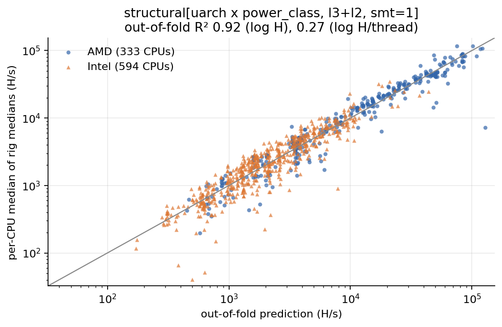
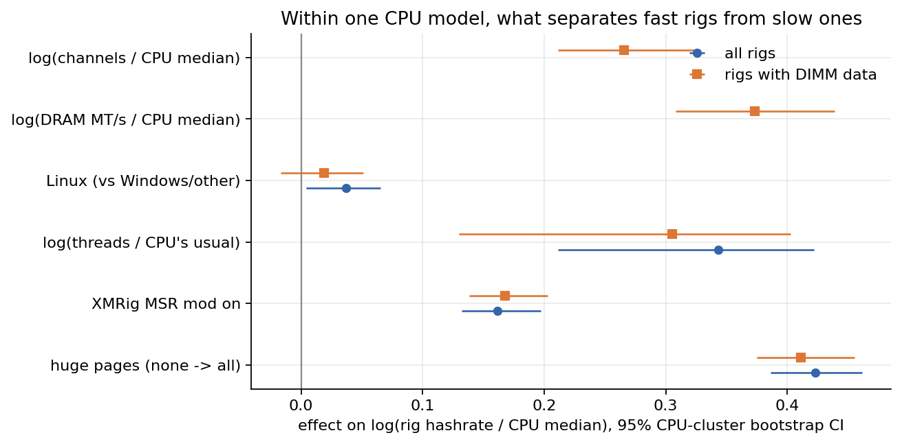
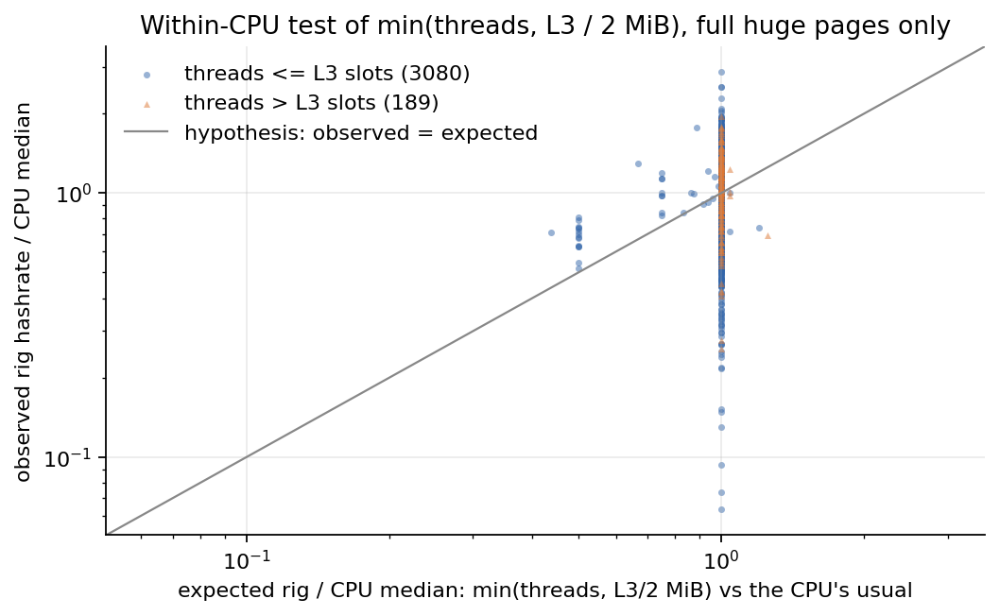
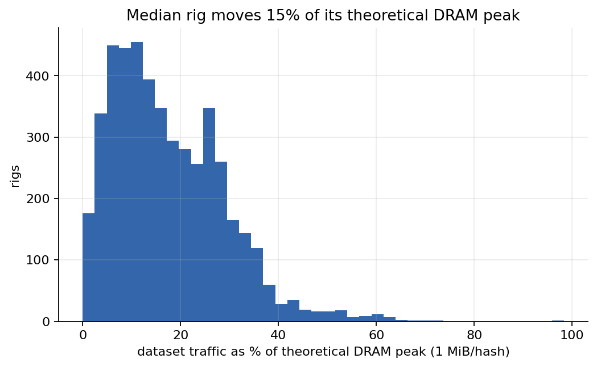

# Hardware model: what sets RandomX speed on a CPU

This part of the repository asks which hardware properties determine RandomX
hashrate across CPUs. It uses the public XMRig benchmark database
(api.xmrig.com) rather than local runs. The data is crawled, cleaned and
grouped into physical rigs. A two-term structural model, `hashrate = r(uarch) x
min(threads, L3 / 2 MiB)`, is then cross-validated against free-form
regressions. Configuration effects (huge pages, MSR mod, DRAM) are measured
within a single CPU model. The Apple M-series rows are placed on the same scale.
A separate economics snapshot converts hashrate into USD per day and a
break-even efficiency in H/s per watt.

All numbers below come from [results/hardware_model.json](../results/hardware_model.json)
and [results/economics_snapshot.json](../results/economics_snapshot.json) unless
stated otherwise.

## Summary

| question | answer |
|---|---|
| Is the leaderboard headline a typical value? | No. For 392 CPUs with >= 3 rigs, headline / typical rig has median 1.60x (10th-90th percentile 1.139x-2.492x) and exceeds 1.10x for 92.6% of CPUs. |
| What explains cross-CPU hashrate? | Thread count alone gives out-of-fold R^2 0.891 on log hashrate but 0.018 on log per-thread rate (0.942 and 0.004 on the 392 CPUs with >= 3 rigs). The structural model with a per-(microarchitecture x power class) rate raises per-thread R^2 to 0.447 on those 392 CPUs (0.273 on all 927). |
| Does the L3 / 2 MiB cap help? | Yes, modestly. On CPUs with >= 3 rigs (the robust set), per-thread R^2 goes from 0.238 without a cap to 0.319 with it (microarchitecture-only rate). |
| Does a flexible regression beat the structural form? | Not on the robust set: there the structural model scores 0.9678 / 0.4473 and the best log-linear model 0.9675 / 0.4419 (log H / log per-thread). On all 927 CPUs the log-linear model is ahead (0.9234 / 0.3066 against 0.9197 / 0.2738 for the best structural variant). |
| What moves a rig within one CPU model? | Huge pages none -> all: +52.7%. XMRig MSR mod: +17.55%. DRAM MT/s elasticity 0.373. Memory-channel elasticity 0.2655. |
| Is DRAM bandwidth the cap? | Not for most rigs. The median rig moves 15.4% of theoretical DRAM peak (p99 53.0%). |
| Apple M4 | One 10M run: 4,072 H/s at 10 threads. Median per-thread rate over all run sizes: 395.4 H/s. |
| Economics (block 3,771,315) | $0.03785 per kH/s-day. Break-even 63.4 H/W at $0.10/kWh and 95.1 H/W at $0.15/kWh. |

## Code and outputs

| path | role |
|---|---|
| [rxlab/analysis/leaderboard.py](../rxlab/analysis/leaderboard.py) | cached crawler for api.xmrig.com, submission flattening, SMBIOS memory parser, rig grouping, per-CPU table, microarchitecture and power-class labels, `StructuralModel`, `LogLinear`, repeated k-fold CV, DRAM-demand fraction |
| [experiments/hardware_model.py](../experiments/hardware_model.py) | builds `results/hardware_model.json` and the six `hw_*.png` figures from `rigs.csv` (and the crawl cache, when present) |
| [data/leaderboard/rigs.csv](../data/leaderboard/rigs.csv), [data/leaderboard/README.md](../data/leaderboard/README.md) | data shipped with the repository: one row per physical rig (5,726 rows, 1.0 MB), with provenance and column definitions |
| [results/hardware_model.json](../results/hardware_model.json) | model comparison, fitted rates, within-CPU effects, cache-saturation test, DRAM demand, headline bias, Apple table, `apple_m4` export |
| [rxlab/econ.py](../rxlab/econ.py), [experiments/economics.py](../experiments/economics.py) | chain and price snapshot, USD per H/s-day, break-even H/W |
| [results/economics_snapshot.json](../results/economics_snapshot.json) | the economics snapshot, keyed by block height |
| [tests/test_leaderboard.py](../tests/test_leaderboard.py) | offline tests (46 cases): parsing, grouping, filters, labels, parameter recovery on synthetic data, econ formulas, `rigs.csv` consistency |
| `figures/hw_*.png` | six figures, embedded below |

## Data: the XMRig benchmark database

### Endpoints

| stage | endpoint | content |
|---|---|---|
| index | `GET /1/benchmarks?algo=rx/0` | one row per CPU brand string: `count`, `size` (total hashes over all runs) and `hashrate`, which is the **maximum** submission. The public leaderboard page is rendered from this. |
| brand list | `GET /1/benchmarks?algo=rx/0&cpu=<brand>` | every submission of that brand, no paging: id, size, status, threads, hashrate, os, version, `cpu.packages` |
| submission | `GET /1/benchmark/<id>` | full hwloc CPU info (cores, threads, L2, L3, CPUID family/model, packages), SMBIOS (board, DIMMs with type/speed/part number/bank label), backend (huge pages, MSR mod), per-thread hashrates |

`/1/cpus` does not exist (404). The index `size` is the total number of hashes
over all of a brand's runs, so `size > count x 1M` identifies brands with at
least one run longer than 1M hashes. Only those brand lists are fetched. The
crawler allows at most 4 concurrent requests, retries with exponential backoff,
and caches every raw response gzipped under `data/cache/xmrig/` (git-ignored,
45 MB).

### Funnel

| stage | count |
|---|---|
| submissions in the index / brand strings | 89,776 / 2,334 |
| brands with any run longer than 1M (lists fetched) | 1,184 |
| submissions in those lists | 85,190 |
| `rx/0`, finished (`status == 3`), `size >= 10M` | 12,145 |
| ... and `cpu.packages == 1` (details fetched) | 9,604 (0 missing, 9,604 usable) |
| rigs | 5,726 (5,511 by SMBIOS, 11 by submitter name, 204 anonymous pools) |
| x86 CPUs in the model | 927 (392 with >= 3 rigs) |
| brand strings excluded from the x86 model | 59 |

### Filters and why

- **Build from submissions, never from the index headline.** The headline is
  the maximum over every submission of a brand, including short bursts and
  multi-socket systems. It is a biased estimate of a typical machine (see
  [headline bias](#the-leaderboard-headline-is-not-a-typical-value)).
- **`size >= 10M` hashes.** 1M runs are short bursts (1e6 / hashrate: about
  12 s at 80 kH/s, about 4 minutes on an M4) and inflate numbers. 10M runs are
  still only a burst, not sustained operation.
- **`cpu.packages == 1`.** Multi-socket rows are whole systems (about 2x).
  VMs that present every vCPU as its own socket also drop out here.
- **Group into rigs, take the median.** One person resubmitting the same
  machine many times must not dominate a CPU. The rig hashrate is the median of
  its runs.
- **Modal topology per brand.** `cpu_table()` keeps only the rigs whose
  `(cores, L3)` equals the brand's most common topology. This removes VM slices
  and spoofed or misreported brand strings; brand strings are never trusted for
  topology. The per-CPU value is the median of rig medians.
- **x86 model set.** A CPU enters the model if its reported vendor is AMD,
  Intel or Hygon, it is not Apple, and it has L3 >= 2 MiB and a reported L2.
  The 59 excluded brands are rows whose reported vendor is `other` (ARM cores,
  Kunpeng, Snapdragon X Elite, generic virtual CPUs such as QEMU and KVM, and
  the one Hygon part in the data, Hygon C86 7380), CPUs whose reported L3 is
  below 2 MiB or whose L2 is missing (for example Celeron/Pentium N-series,
  Core 2, older AMD APUs and Haswell/Broadwell i7 HQ parts that report no L2
  or L3), and a few other virtual CPUs. They are listed in
  `excluded_non_x86_or_l3_under_2mib`.

### Rig identity

| basis | key | notes |
|---|---|---|
| `dmi` | (cpu brand, cores, os, board product, sorted set of DIMM part numbers, DIMM count) | Identical off-the-shelf machines owned by different people merge on purpose, so a popular prebuilt cannot outvote everything else. |
| `user` | (cpu, cores, os, submitter name) | The name is not stored; `rig_id` is a truncated SHA-1 of the key. |
| `anon` | (cpu, cores, os) | All anonymous runs of a CPU/OS pool into one pseudo-rig, which is conservative. |

macOS submissions never carry SMBIOS, so Apple rigs are `user` or `anon`.

### Memory fields from SMBIOS

- `mem_mts` is the slowest populated DIMM's reported speed. It is left empty
  when the value is below the lowest JEDEC grade of its type (DDR2 400, DDR3
  800, DDR4 1600, DDR5 3200), because such a value is the I/O clock rather than
  the transfer rate.
- `channels` counts distinct 64-bit channels parsed from free-text bank/slot
  labels (`P0 CHANNEL A`, `ChannelB-DIMM0`, `P0_Node1_Channel2_Dimm0`,
  `DIMM_P0_C0`, `DDR5-A2`, `Controller1-DIMMB2`, ...). It is empty when any
  DIMM's label has no channel information (EPYC 9004 `A1`..`A12`,
  `PROC 1 DIMM 3`), and for LPDDR, whose 16/32-bit channels are not comparable.
- Microarchitecture comes from CPUID family/model, not the brand string
  (Zen 1-5, Intel client and server generations). Unknown Intel models keep an
  `intel-f<family>-m<model>` label.

## The leaderboard headline is not a typical value


For the 392 x86 CPUs with >= 3 rigs, `index headline / median of rig medians`:

| ratio | p10 | median | p90 | share > 1.10x |
|---|---|---|---|---|
| index headline / typical rig | 1.139 | 1.60 | 2.492 | 92.6% |
| largest run inside the filtered set / typical rig | 1.041 | 1.253 | 1.749 | 78.83% |

The second row takes the largest run that passes every filter (10M, one socket,
modal topology). In log terms it accounts for about half of the headline gap,
which is the max-vs-median effect alone. The rest comes from rows the filters
drop: 1M bursts, multi-socket systems and off-topology rows. The most extreme
case is the Xeon Platinum 8272CL, with a headline of 26,600 H/s against a
typical 984.6 H/s (27.01x, 3 rigs).

## The structural model

### Form

For each CPU (median of rig medians, at the most common thread count `T`
among its rigs):

```
log H = log r[level] + log T_eff
t     = min(T, slots)
T_eff = min(t, cores) + s * max(0, t - cores)
slots = L3 / 2 MiB  |  (L3 + L2) / 2 MiB  |  unlimited
```

2 MiB is the RandomX scratchpad (`SCRATCHPAD_L3 = 2097152` in
[rxlab/spec/params.py](../rxlab/spec/params.py)). The hypothesis says each
hashing thread needs its scratchpad resident in cache, so threads beyond
`L3 / 2 MiB` add nothing. `s` weights threads beyond the physical core count
(SMT). It is either fixed at 1, the literal hypothesis, or chosen on the
training folds from a 21-point grid on [0, 1].

The rate `r` is a partially pooled mean of `log(H / T_eff)`, organised as a
hierarchy: global -> vendor -> microarchitecture -> (microarchitecture x power
class). Each level is shrunk toward its parent with a prior weight of 2
pseudo-rows, and levels unseen in training fall back to the parent. This keeps
a level seen in one training CPU from getting a noisy rate.

The hypothesis names `per_thread_rate(arch, clock)`, but XMRig submissions
carry no clock. The **power class** stands in for the clock term. It is derived
from the brand string: server (EPYC, Xeon, Opteron), hedt (Threadripper, Intel
`X`/`XE`), mobile (Intel/AMD SKU suffixes U, Y, P, H, HK, HQ, HX, HS, M, QM,
MQ, V, Intel `G<n>`, other 3-4 digit model numbers ending in M, U or Y, and
`Ryzen AI` brand strings), desktop, and unknown (engineering samples and
virtual CPUs). iGPU names such as "Radeon 780M" are cut off before the mobile
patterns are matched.

### Baselines and validation design

- **Log-linear baselines** fit least squares of log H on log features
  (threads, cores, L3, L2, and the slot term `log min(threads, L3 / 2 MiB)`)
  plus one-hot categories (vendor, microarchitecture, power class). A ridge
  penalty (lambda = 1) applies to the category effects only, implemented as
  augmented rows in `numpy.linalg.lstsq`.
- **Cross-validation.** 10 folds, repeated 5 times with seeds 0-4. The unit is
  one CPU.
- **Metrics.** R^2 is reported on log hashrate and on log per-thread rate
  (`log H - log threads`). Hashrates in `rigs.csv` span more than three orders
  of magnitude, so thread count alone explains most of the variance of log H.
  The per-thread R^2 shows what the hardware specs add beyond that.
- **Median absolute error** is the median of `exp(|log error|) - 1` over the
  first repeat. It is a symmetric ratio error: a prediction off by 1.25x in
  either direction counts as 25%.
- **Two populations.** Every model is scored on all 927 CPUs and on the 392
  CPUs with >= 3 rigs. Single-rig CPUs make per-CPU medians noisy.

### Results

Out-of-fold R^2, mean over 5 repeats (log H / log per-thread), and median
absolute error:

| model | all 927 CPUs | MdAE | 392 CPUs, >= 3 rigs | MdAE |
|---|---|---|---|---|
| log-linear: threads only | 0.8914 / 0.0177 | 32.68% | 0.9421 / 0.0039 | 25.18% |
| log-linear: threads, cores, L3, L2 + vendor | 0.8930 / 0.0317 | 32.29% | 0.9520 / 0.1752 | 20.59% |
| log-linear: threads, cores, L3, L2 + uarch | 0.9104 / 0.1897 | 27.27% | 0.9572 / 0.2638 | 18.87% |
| structural r(uarch), no cache cap, s = 1 | 0.9105 / 0.1906 | 26.80% | 0.9557 / 0.2376 | 21.38% |
| **structural r(uarch) x min(T, L3/2 MiB), s = 1** (literal hypothesis) | 0.9127 / 0.2105 | 26.58% | 0.9604 / 0.3189 | 20.08% |
| same, s fitted | 0.9126 / 0.2090 | 26.53% | 0.9607 / 0.3247 | 20.85% |
| same, (L3 + L2) / 2 MiB | 0.9122 / 0.2059 | 26.46% | 0.9578 / 0.2752 | 21.15% |
| structural r(uarch x power), no cache cap, s = 1 | 0.9184 / 0.2620 | 23.53% | 0.9658 / 0.4129 | 15.10% |
| **structural r(uarch x power) x min(T, L3/2 MiB), s = 1** | 0.9196 / 0.2731 | 22.83% | 0.9678 / 0.4473 | 14.56% |
| same, s fitted | 0.9194 / 0.2709 | 22.96% | 0.9682 / 0.4525 | 14.51% |
| same, (L3 + L2) / 2 MiB | 0.9197 / 0.2738 | 23.23% | 0.9675 / 0.4405 | 14.80% |
| log-linear: slot term + uarch + power class | 0.9195 / 0.2713 | 23.31% | 0.9674 / 0.4393 | 14.75% |
| log-linear: threads, cores, L3, L2, slot term + uarch + power class | 0.9234 / 0.3066 | 23.14% | 0.9675 / 0.4419 | 13.73% |

The repeat-to-repeat standard deviation of the per-thread R^2 is 0.0011-0.0123
across these models. Differences below about 0.01 are therefore within
fold-split noise. This SD does not capture sampling variation across CPUs.



What the table shows:

- **Threads explain log H but not the per-thread rate.** Thread count alone
  reaches R^2 0.891 (0.942 on robust CPUs) on log hashrate but 0.018 (0.004)
  on the per-thread rate.
- **The L3 slot cap helps.** On robust CPUs it lifts per-thread R^2 from 0.2376
  (no cap) to 0.3189 (L3 cap) with a microarchitecture-only rate. With the power
  class the gain is 0.4129 -> 0.4473.
- **L3 vs L3 + L2 is close to a tie with the power class.** On all CPUs the two
  score 0.2731 vs 0.2738. On robust CPUs L3 scores higher (0.4473 vs 0.4405),
  and with a microarchitecture-only rate the L3 lead on robust CPUs is larger
  (0.3189 vs 0.2752).
- **The clock proxy matters as much as the architecture.** Adding the power
  class raises robust per-thread R^2 from 0.3189 to 0.4473 and cuts median
  absolute error from 20.08% to 14.56%.
- **On robust CPUs the structural form loses nothing against a free-form
  fit.** The best log-linear model has more parameters and reaches 0.9675 /
  0.4419 on robust CPUs, against 0.9678 / 0.4473 for the structural model. Its
  median absolute error is lower (13.73% vs 14.56%). On all 927 CPUs the same
  log-linear model is ahead: 0.9234 / 0.3066 against 0.9197 / 0.2738 for the
  best structural variant, a per-thread gap well above the repeat-to-repeat
  SD.
- **The SMT weight is barely identified.** Fitting `s` on all rows gives
  0.8-0.95 on all CPUs and 0.75 on robust CPUs. Fitted and fixed (`s = 1`)
  variants still score within 0.01 R^2 of each other. The reason is that thread
  counts barely vary independently of topology: 81.86% of x86 rigs run exactly
  `min(logical CPUs, floor(L3 / 2 MiB))` threads, and 11.6% run more threads
  than L3 slots.
- **Most per-thread variance is still unexplained.** The highest per-thread
  R^2 of any model here is 0.4525 (structural, power class, L3 cap, `s`
  fitted, robust CPUs). The within-CPU analysis below shows where much of the
  rest goes.

The experiment selects `best_structural` by all-CPU log-H R^2. That picks
`structural[uarch x power_class, l3+l2, smt=1]` (0.9197 vs 0.9196 for the L3
variant, effectively a tie). The fitted rates and `hw_structural_fit.png` come
from that variant.

### Fitted per-thread rates

H/s per effective thread, from the full-data fit (`best_structural_full_fit`:
`T_eff` from `(L3 + L2) / 2 MiB`, `s = 1`, partially pooled):

| microarchitecture | desktop | mobile | server | hedt |
|---|---|---|---|---|
| Zen 2 | 526.8 | 411.0 | 361.4 | 440.4 |
| Zen 3 | 476.8 | 428.2 | 391.3 | 479.2 |
| Zen 4 | 553.0 | 491.0 | 438.1 | 541.4 |
| Zen 5 | 644.3 | 432.0 | 468.8 | 544.6 |
| Haswell | 389.2 | 341.3 | 417.0 | 427.5 |
| Skylake family (client) | 428.4 | 330.3 | 442.2 | - |
| Skylake-SP | - | - | 377.5 | 512.1 |
| Alder Lake | 425.3 | 230.8 | - | - |
| Raptor Lake | 323.1 | 238.7 | - | - |
| Arrow Lake | 408.4 | 340.8 | - | - |

The vendor-level rates are AMD 425.5 and Intel 353.2. The full per-uarch and
per-(uarch, power class) tables are in the JSON. Some levels rest on few CPUs
and are shrunk toward their parent.


### Feature importance

Feature importance is scored on the 704 CPUs whose rigs report DRAM speed,
channel count and type (`memory_models`), using log-linear models and the same
CV. Threads-only per-thread R^2 is -0.003. The full model (all numeric features
plus uarch, vendor, power class and DDR type) reaches 0.3514.

| feature | per-thread R^2 gain, added alone to threads-only | per-thread R^2 loss, dropped from full |
|---|---|---|
| microarchitecture | +0.175 | 0.0367 |
| slot term `min(threads, L3/2 MiB)` | +0.0917 | 0.0377 |
| power class | +0.0808 | 0.0572 |
| L3 | +0.0549 | -0.0002 |
| vendor | +0.0478 | -0.0005 |
| DRAM MT/s | +0.0442 | 0.0250 |
| DDR type | +0.0348 | -0.0045 |
| memory channels | +0.0240 | 0.0239 |
| cores | -0.0007 | 0.0040 |
| L2 | +0.0008 | -0.0006 |

At the CPU level, memory features add about 0.05 per-thread R^2. A log-linear
model on specs + uarch scores 0.2464; adding MT/s, channels and DDR type raises
it to 0.2945. The best structural model scores 0.2578 on this subset.

### Residual outliers

These are the largest out-of-fold residuals among CPUs with >= 3 rigs
(`residual_outliers_min3_rigs`, observed / predicted):

| slower than predicted | ratio | faster than predicted | ratio |
|---|---|---|---|
| Core Ultra 9 275HX (Arrow Lake, mobile) | 0.433 | Core i7-7820HQ (Skylake, mobile) | 1.903 |
| Xeon E5-2620 (Sandy Bridge, server) | 0.4922 | AMD Eng Sample 100-000001458-01 (Zen 5, unknown) | 1.765 |
| Core i7-14700 (Raptor Lake, desktop) | 0.5081 | Core i7-3770K (Ivy Bridge, desktop) | 1.763 |
| Core i3-4150 (Haswell, desktop) | 0.523 | Core i9-13900H (Raptor Lake, mobile) | 1.737 |

These residuals are the first repeat's out-of-fold predictions of
`best_structural`, the (L3 + L2) variant. Two hybrid Intel parts (Core Ultra
9 275HX, Core i7-14700) sit on the slow side, where E-core threads count as
full threads in `T_eff`; another hybrid part, the Core i9-13900H, sits on the
fast side. See [limitations](#known-limitations-and-open-questions).

## Within one CPU model

This analysis uses rigs of x86-model CPUs with >= 5 rigs that match the CPU's
modal topology and report huge-page and MSR status: 4,301 rigs over 242 CPUs. The
response is `log(rig hashrate / CPU median)`. Features are the huge-page
success fraction, MSR mod on/off, `log(threads / CPU's usual)` and Linux vs
other. A second fit adds `log(DRAM MT/s / CPU median)` and
`log(channels / CPU median)` on the 3,860 rigs (238 CPUs) with memory data.
The 95% intervals are the 2.5/97.5 percentiles of 500 CPU-cluster bootstrap
draws. CV holds whole CPUs out.

Rigs of the same CPU spread widely. The rig / CPU median ratio has p10 0.5958,
p25 0.8379, p75 1.11 and p90 1.26.

| effect (log scale, 95% CI) | all rigs (n = 4,301) | rigs with DIMM data (n = 3,860) |
|---|---|---|
| huge pages, none -> all | 0.4233 (0.3865-0.4616), +52.7% | 0.4112 (0.3751-0.4556), +50.86% |
| XMRig MSR mod on | 0.1617 (0.1323-0.1973), +17.55% | 0.1678 (0.1382-0.2029), +18.27% |
| log(threads / CPU's usual), elasticity | 0.3432 (0.2114-0.4222) | 0.3052 (0.1300-0.4028) |
| Linux vs Windows/other | 0.03679 (0.004178-0.06558), +3.75% | 0.01918 (-0.01695 to 0.05098), not significant |
| log(DRAM MT/s / CPU median), elasticity | - | 0.373 (0.3082-0.4391) |
| log(channels / CPU median), elasticity | - | 0.2655 (0.2112-0.3283) |
| R^2 in sample / CPU-grouped CV | 0.3307 / 0.3272 | 0.422 / 0.4167 |

An MT/s elasticity of 0.373 means +10% DRAM transfer rate gives about +3.6%
hashrate. The Linux effect is not significant once memory is in the model.

Descriptive checks agree with the regression:

| group | n | median rig / CPU median |
|---|---|---|
| no huge pages (fraction 0) | 581 | 0.6626 |
| partial huge pages | 451 | 0.7974 |
| full huge pages (>= 0.99) | 3,269 | 1.038 |
| single-channel rig, on a CPU whose rigs are usually dual-channel (full huge pages) | 204 | 0.956 |
| dual-channel rig, same CPUs | 2,153 | 1.053 |



### Direct test of `min(threads, L3 / 2 MiB)` inside a CPU

This test uses the 3,269 full-huge-page rigs over 240 CPUs
(`cache_saturation`). For each rig, the expected ratio is
`T_eff(rig threads) / T_eff(CPU's usual thread count)`, compared with the
observed rig / CPU median. If the hypothesis holds, the slope of log observed
on log expected is 1.

- **SMT threads counted fully (`s = 1`).** Only 32 rigs run a thread count
  whose expected ratio differs from their CPU's usual by more than 5% (31 fewer
  threads, 1 more). For them the slope is 0.5028 (95% CI 0.3713-0.6314), not
  1.
- **SMT threads weighted 0.** Only 6 of those rigs still differ from their
  CPU's usual (slope 0.1406, CI -0.8585 to 1.161). The `s = 1` slope therefore
  mostly measures the value of the second hyperthread, which is worth about
  half a core.
- **Oversubscribing the cache.** The 189 rigs that run more than 1.05x as many
  threads as L3 slots sit at a median 1.078x of expectation (observed /
  expected with `s = 1`, so threads beyond the slots add nothing to the
  expectation), against a median observed ratio of 1.038x for
  full-huge-page rigs at the usual count. Oversubscription gains roughly +4% on
  those CPUs, which are mostly Intel.

The test is weak because thread counts barely vary within a CPU.



## DRAM demand

Each hash runs `PROGRAM_COUNT x PROGRAM_ITERATIONS` = 8 x 2048 dataset reads of
`DATASET_ITEM_SIZE` = 64 B, which is 1 MiB of dataset traffic per hash. The
dataset itself is about 2080 MiB. The theoretical peak is
`channels x 8 B x MT/s`, so the fraction of peak used is
`hashrate x 1 MiB / (channels x 8 B x MT/s)`
(`dram_demand_fraction` in [leaderboard.py](../rxlab/analysis/leaderboard.py)).

| rigs with 64-bit channel and speed data | median | p90 | p99 | share > 25% |
|---|---|---|---|---|
| 4,705 | 15.37% | 32.42% | 53.02% | 25.44% |

The one rig near 100% (97.32%) is a Threadripper 3990X reporting 4 channels of
DDR4 at 1600 MT/s. That is probably DDR4-3200 reported as its clock, which the
JEDEC-floor rule cannot detect.

Bandwidth is mostly idle, yet DRAM MT/s and channel count still matter within a
CPU. The data are consistent with a latency or concurrency limit rather than a
bandwidth cap. This is an inference from the data, not a measurement.



## Apple M-series

Apple parts are kept out of the x86 model. They have no L3; `rigs.csv` records
L3 = 0 and L2 as the sum over clusters, and a system-level cache sits behind
that. Hyphenated brand spellings (`Apple M2-Max`) merge with spaced ones. Few
Apple runs are 10M, so the table reports every finished `rx/0` submission,
split into 10M and shorter runs. At about 4,000 H/s a 1M run lasts about 4
minutes; shorter runs serve as context only.

| chip | typical threads | submissions (10M) | median 10M, H/s | median < 10M, H/s | index headline, H/s | median H/s per thread, all sizes |
|---|---|---|---|---|---|---|
| M1 | 8 | 100 (11) | 2,084 | 2,186 | 2,496 | 280.7 |
| M1 Pro | 10 | 28 (1) | 3,015 | 3,146 | 3,514 | 325.5 |
| M1 Max | 10 | 25 (5) | 3,473 | 3,413 | 3,718 | 342.9 |
| M1 Ultra | 20 | 8 (4) | 3,606 | 6,236 | 6,466 | 301.4 |
| M2 | 8 | 42 (3) | 2,650 | 2,658 | 2,893 | 331.7 |
| M2 Pro | 12 | 17 (2) | 3,538 | 4,615 | 4,722 | 384.6 |
| M2 Max | 12 | 17 (1) | 4,491 | 4,627 | 5,185 | 384.4 |
| M2 Ultra | 24 | 5 (1) | 7,711 | 8,012 | 8,440 | 327.4 |
| M3 | 8 | 11 (1) | 1,599 | 2,947 | 3,367 | 368.9 |
| M3 Pro | 12 | 5 (1) | 4,073 | 3,954 | 4,156 | 339.4 |
| M3 Max | 16 | 19 (1) | 7,547 | 7,346 | 7,582 | 462.5 |
| M3 Ultra | 32 | 2 (1) | 12,690 | 12,720 | 12,720 | 397.2 |
| M4 | 10 | 27 (1) | 4,072 | 3,940 | 4,427 | 395.4 |
| M4 Pro | 12 | 19 (0) | - | 5,691 | 6,819 | 470.7 |
| M4 Max | 16 | 13 (3) | 6,209 | 7,706 | 8,585 | 500.0 |
| M5 | 10 | 3 (0) | - | 4,319 | 4,786 | 431.9 |
| M5 Pro | 18 | 2 (1) | 7,354 | 7,433 | 7,433 | 410.7 |
| M5 Max | 18 | 1 (0) | - | 7,922 | 7,922 | 440.1 |

For some chips the 10M median sits far below the bursts (M3: 1,599 vs 2,947
H/s; M1 Ultra: 3,606 vs 6,236 H/s). With one or a few 10M runs per chip, the
10M column is not a robust estimate.

**M4 rows.** Apple M4 has 27 `rx/0` submissions. One is a 10M run (id
`26MTpY`: 4,072 H/s at 10 threads, XMRig 6.25.0, huge pages 0 of 1,178, since
macOS provides none to XMRig). The 26 shorter runs have median 3,940 H/s and
range from 3,287 to 4,427 H/s; the index headline, 4,427 H/s, is a 1M run. The
full M4 list is exported as `apple_m4` in the JSON. It exists for comparison
with this repository's own M4 measurements, which use the reference RandomX
library rather than XMRig's JIT. Three caveats come with the export: XMRig
cannot tell a fanless MacBook Air from a MacBook Pro, Mac mini or iMac M4; only
10M rows pass the repository's filter; and macOS gives XMRig no thread
affinity, so its per-thread split is not per-core.

**Placement.** Apple per-thread rates are `hashrate / threads` over runs of
every size, with no cache cap. The x86 rates are H/s per effective thread over
10M runs. The two are shown on one axis in `hw_per_thread_rate.png` but are not
strictly comparable. With that caveat, the M4 median of 395.4 H/s per thread is
close to the fitted Skylake-family rate (396.8) and below Zen 3 (433.8) and
Zen 4 (484.1), using the uarch-level rates of `best_structural_full_fit`.

## Economics snapshot

[rxlab/econ.py](../rxlab/econ.py) polls eight public monerod JSON-RPC nodes
for their tip and uses the tip that most nodes agree on (ties broken by height,
then sorted order). From one agreeing node it then reads `get_info` and the
last 720 block headers; the last header is the tip, and its hash is checked
against the polled tip. Snapshots are keyed by block height. The price comes
from CoinGecko, with Kraken recorded as a cross-check. Every node's answer or
failure is stored in the JSON.

```
usd_per_hs_day    = 86400 * reward_xmr * usd_per_xmr / difficulty
breakeven_h_per_w = 0.024 kWh/(W*day) * usd_per_kwh / usd_per_hs_day
```

| quantity | value |
|---|---|
| block height | 3,771,315 |
| nodes agreeing on the tip | 4 of 8; the other 4 failed with `URLError` |
| difficulty | 766,104,722,765 (network ~6.384 GH/s at a 120 s target) |
| tip block reward | 0.60297582 XMR (0.6 XMR tail emission; fees are 0.49% of the reward) |
| XMR/USD | $556.59 (CoinGecko); Kraken $556.10 |
| USD per H/s-day | 3.785e-5 |
| **USD per kH/s-day** | **$0.03785** (6.800e-5 XMR) |
| 720-block means (87,199 s window) | reward 0.60766 XMR, difficulty 758.5 G, USD per H/s-day 3.852e-5 |

Break-even efficiency, H/s per watt at the wall:

| electricity price | tip block | 720-block mean |
|---|---|---|
| $0.05/kWh | 31.7 | 31.1 |
| $0.10/kWh | 63.4 | 62.3 |
| $0.15/kWh | 95.1 | 93.4 |
| $0.20/kWh | 126.8 | 124.6 |

Break-even ignores pool fees (typically 0-1%), hardware cost and luck variance.
H/W means hashrate per watt at the wall, not per watt of CPU package power.

Combining the two result files: the single 10M M4 run (4,072 H/s) would earn
about $0.154 per day. It breaks even only if the whole machine draws less than
64.2 W at $0.10/kWh or 42.8 W at $0.15/kWh. Its power was not measured in this
database.

## Reproducing

```
python3 experiments/hardware_model.py            # replay data/cache/xmrig/ if present, else model from rigs.csv
python3 experiments/hardware_model.py --rebuild  # crawl anything not cached, rewrite rigs.csv, rerun the model
python3 experiments/hardware_model.py --offline  # never touch the network (requires the cache)
python3 experiments/economics.py                 # new snapshot; overwrites results/economics_snapshot.json
python3 -m pytest tests/test_leaderboard.py      # offline tests
```

When the crawl cache exists, the experiment always replays it, so
`crawl_counts` in the output does not depend on a flag. Without the cache,
`crawl_counts` is `null` and the headline comparison and the Apple table fetch
the live index and Apple brand lists. The first crawl is network-bound and
takes about an hour at the 4-request limit. Replaying the cache takes under a
minute. Both durations were measured on a loaded machine and are not a
benchmark result.

## Validation

- **Parameter recovery.** On synthetic CPUs with known per-uarch rates and a
  known SMT weight of 0.5, `StructuralModel` with pooling disabled recovers the
  rates to 1e-9 relative error, recovers `s = 0.5`, and reaches CV R^2 = 1.
  `LogLinear` recovers its generating coefficients.
- **Parser tests on real data.** The SMBIOS channel-parser tests use 11 label
  triples copied verbatim from api.xmrig.com submissions. Each occurs in the
  cached submissions, on 9 to 1,237 DIMMs.
- **Label tables.** The microarchitecture table agrees with CPUID family/model:
  the Zen 1-5 model ranges and the Intel client/server model numbers.
- **The crawl pre-filter loses no 10M run.** Each of the 1,150 skipped brands
  has `size == count x 1M` exactly, and no run shorter than 1M appears among the
  85,190 listed rows.
- **Spot check.** The M4 10M run (`26MTpY`) matches the raw cached submission.
- **Economics by hand.** `86400 x 0.60298 x 556.59 / 766.1e9 = 3.785e-5` USD
  per H/s-day, and `0.0024 / 3.785e-5 = 63.4` H/W.
- **Statistical design.** CV folds are seeded; within-CPU CV holds whole CPUs
  out; bootstraps resample CPUs. `r2()` raises on any non-finite value.
- **Determinism.** Two full reruns from the cache, one with the default hash
  seed and one with `PYTHONHASHSEED=12345`, produced byte-identical
  `hardware_model.json` (md5 `3a57081895545b4760a4dd1b17ce64de`), `rigs.csv`
  and `hw_*.png`.

## Development notes

Notable bugs found while building the pipeline, and their fixes:

- **Singular normal equations.** The log-linear baseline used
  `np.linalg.solve` on the normal equations and failed on a fold with collinear
  features (threads, cores and L3 can coincide within a fold). It now uses
  `lstsq` on ridge-augmented rows.
- **`log(0)` in the slot term.** `log(min(threads, L3 / 2 MiB))` was `log(0)`
  for CPUs with L3 < 2 MiB (Atoms, some VMs). CPUs with fewer than one L3 slot
  are now excluded from the x86 model and listed in the results.
- **Spurious floating-point warnings.** numpy 2.0.2 with Apple Accelerate emits
  "divide by zero encountered in matmul" RuntimeWarnings on finite inputs.
  Every operand and result was checked to be finite. That one message is
  filtered, and `r2()` raises on non-finite values so a real problem cannot
  hide behind the filter.
- **SMBIOS channel parser.** `DIMM_P0_A1` was read as channel "P" (the socket
  prefix); an optional `P<n>_` prefix now handles it. EPYC 9004 boards label
  DIMMs `A1`..`A12` (socket A, slot n). A bare-letter rule turned these into
  "1 channel", which produced DRAM-demand fractions above 100% for 12-channel
  EPYCs; the rule was removed and such rigs now have an unknown channel count.
  `DDR5-A2` (Gigabyte) and `Controller<n>-DIMM<k>` (Intel, one channel per
  controller) were added. Two DIMMs labelled with the same channel are real
  single-channel installs and are kept.
- **SMBIOS clocks read as MT/s.** 57 rigs reported a speed below their type's
  lowest JEDEC grade: 45 DDR4 at 933-1500 and 12 DDR3 at 533-667. Doubled, each
  lands on a common JEDEC or XMP speed (1333 -> 2666, 1500 -> 3000, ...). Their
  `mem_mts` is now empty. They had supplied three of the five rows in the
  earlier DRAM-demand top list.
- **LPDDR channel counts.** 46 LPDDR3/4/5 laptop rigs got 2-8 "channels" from
  labels such as `Controller0-ChannelA`. Those channels are 16 or 32 bits wide,
  so treating them as 64-bit overstated peak bandwidth by up to 4x. `channels`
  is now empty for LP types.
- **Hash-seed nondeterminism.** `_memory` broke DIMM-type ties with
  `max(set(types), ...)`, which depends on `PYTHONHASHSEED`. One cached rig (a
  Xeon L5640 with one "Other" and one "Flash" DIMM) flipped between runs,
  confirmed with six hash seeds. The tie-break is now sorted (`_mode`).
- **Duplicate headline brands.** Some index brand strings differ only in
  whitespace (Ryzen 7 3800X: 11,390 and 10,272 H/s; Xeon E5520). The headline
  dict kept whichever came last. It now takes the maximum under the same
  `_clean` normalisation that `rigs.csv` uses.
- **Apple brand spellings.** `Apple M2-Max` and `Apple M2 Max` are merged by
  normalising hyphens.
- **Power-class parser.** iGPU names were parsed as SKU suffixes: "Radeon 780M"
  made the Ryzen 7 8700G look mobile, so the iGPU name is now cut off first.
  The Intel `P` suffix (i7-1260P) is now mobile. `Genuine Intel(R) CPU 0000%@`
  engineering samples are now unknown.
- **Hygon label.** Hygon was labelled `zen1`, which gave the pooling level
  `("uarch", "zen1")` two parent vendors. It is now `hygon-dhyana`. The one
  Hygon brand in the data (Hygon C86 7380) reports vendor `other` and is
  excluded from the x86 model, so no CPU in the model carries that label and
  no result changed.
- **Flag-dependent output.** A run without `--rebuild` wrote
  `crawl_counts: null`. The experiment now always replays the cache when one
  exists.
- **Economics error handling.** `econ.py` caught `URLError`/`OSError` but not
  `http.client.HTTPException` (IncompleteRead, BadStatusLine and LineTooLong
  are not `OSError`s), so one misbehaving node or price API could abort the
  snapshot. Such failures are now recorded. The tip choice no longer depends on
  set order in a tie. A redundant `get_block_header_by_height` call was replaced
  by the last header of the range, plus a check that its hash equals the polled
  tip.
- **Metric choice.** Every model, including threads-only, scored about 0.9
  R^2 on log hashrate, so R^2 on the log per-thread rate was added. The robust
  (>= 3 rigs) CPU set was added because single-rig CPUs made per-CPU medians
  noisy.
- **Cache-saturation figure.** The first version plotted the rig ratio against
  threads / slots, which mixed huge-page failures into the spread. It was
  replaced by the direct within-CPU test on full-huge-page rigs.
- **Figure accessibility.** The palette's orange/green pair fails a
  colour-vision-deficiency check (protan dE 5.9), so every multi-series figure
  also varies the marker shape.

## Known limitations and open questions

- **No clock or power data.** XMRig submissions carry no frequency, so the
  clock term is a brand-string power-class proxy. Per-thread rate against
  sustained clock would need another data source. There is no power data
  either: H/W cannot be computed from this database, and the M4 break-even
  figures above are arithmetic, not measurements.
- **Burst-only runs.** A run lasts 1e6 or 1e7 / hashrate seconds: 1M runs take
  about 12 s on an 80 kH/s CPU and about 4 minutes on an M4. Nothing
  here measures sustained, thermally settled throughput. That matters most for
  a fanless MacBook Air, which XMRig cannot distinguish from other M4 machines.
- **Offline reproducibility needs the crawl cache.** A fresh clone can
  reproduce everything derived from `rigs.csv`. It cannot reproduce
  `headline_bias`, `apple`, `apple_m4` or `crawl_counts` offline: these need the
  45 MB git-ignored cache in `data/cache/xmrig/`. Without it the experiment
  fetches the live index, which changes as new submissions arrive, and
  `--offline` raises `Offline`. Shipping a small index and Apple-list
  snapshot in the repository would close this gap.
- **Intel hybrid parts.** E-core threads count as full threads in `T_eff`.
  Alder Lake and Raptor Lake get low per-effective-thread rates (322.7 and
  293.9 H/s at the uarch level; 230.8 and 238.7 for mobile parts), and the
  Arrow Lake Core Ultra 9 275HX is the largest slow residual (0.433), which is
  consistent with that. The Arrow Lake uarch-level rate (372.4) is not low by
  comparison with the Intel vendor rate (353.2). A P/E-aware slot count would
  need core-type data that XMRig does not submit.
- **Channel and speed parsing.** Channel counts come from free-text SMBIOS
  labels, and formats without channel information (EPYC 9004 `A1`..`A12`, HP
  `PROC 1 DIMM 3`, `BANK4/DIMM5`) leave `channels` empty. A clock at or above its
  type's JEDEC floor (DDR4-3200 reported as 1600) cannot be detected. The
  97.32% DRAM-demand 3990X rig is probably one of these.
- **Weakly identified terms.** The SMT weight and the cache cap are nearly
  collinear with topology because most users run the same thread count. The
  within-CPU slope test rests on 32 rigs.
- **Default thread count.** Reading the 81.86% of x86 rigs that run exactly
  `min(logical CPUs, floor(L3 / 2 MiB))` threads as "users run XMRig's default
  thread count" infers the default from that match rate. It has not been
  checked against XMRig's source, and XMRig also counts exclusive L2 on some
  AMD parts.
- **Unexplained variance.** The best per-thread R^2 across CPUs is about 0.45.
  The within-CPU features explain 33% of rig-to-rig variance (42% with memory
  features). A large share of the variation is unattributed.
- **DRAM interpretation.** The latency/concurrency reading of the DRAM results
  is an inference; no latency was measured.
- **Apple M1 rows.** The Apple M1 counts and medians include five
  `packages = 2` rows (Linux on Apple silicon, where hwloc reports each cluster
  as a package), one of them a 10M run (2,482 H/s). `rigs_10M` excludes them,
  so `median_submission_10M` and `median_of_rig_medians_10M` for M1 use slightly
  different sets.
- **Implementation vs hardware.** XMRig uses its own RandomX JIT, while this
  repository's M4 measurements use the reference library. Part of any gap to
  `apple_m4` will be implementation, not hardware.
- **Checksum stability.** `machine.power_source` (battery or AC) is written into
  `hardware_model.json`, so the file's checksum can change with charger state
  even when the analysis does not.
- **Economics is a single snapshot.** Revenue scales with price / difficulty at
  one block height. Pool fees, hardware cost and luck variance are excluded.
