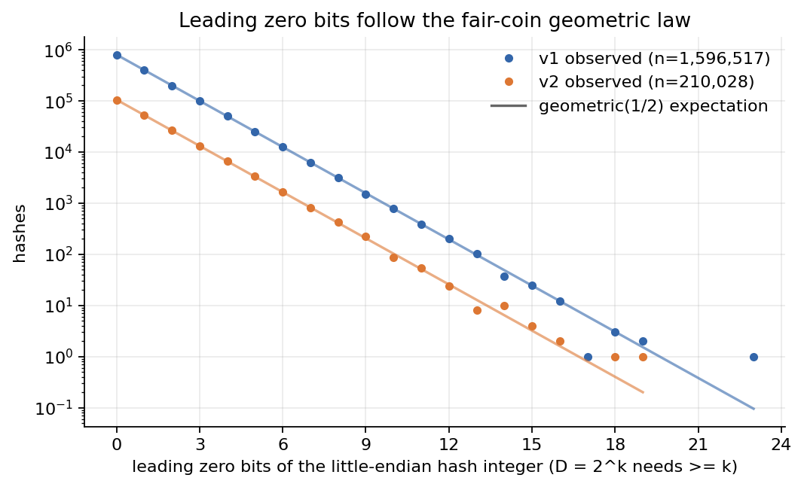
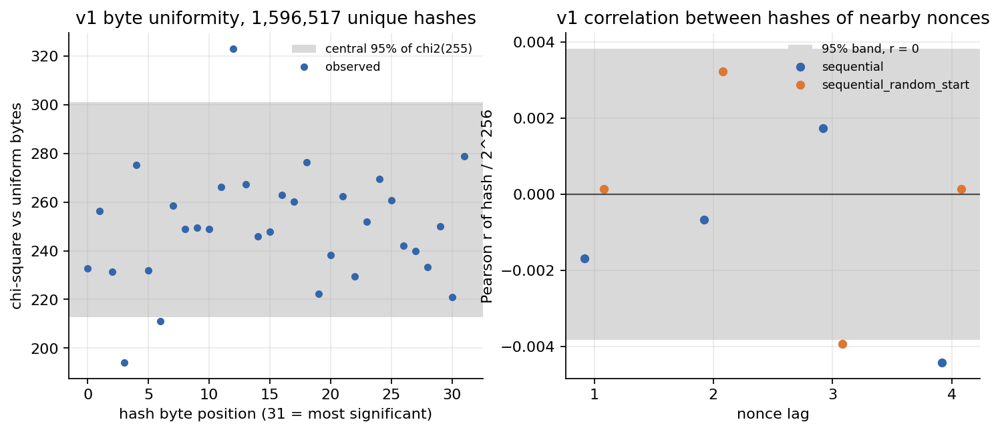
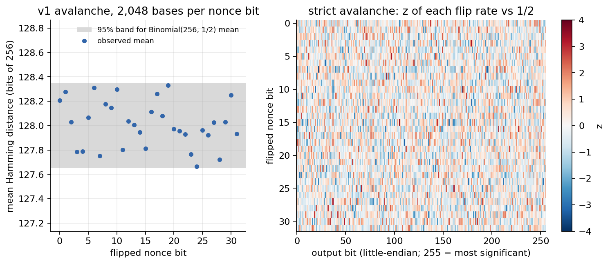
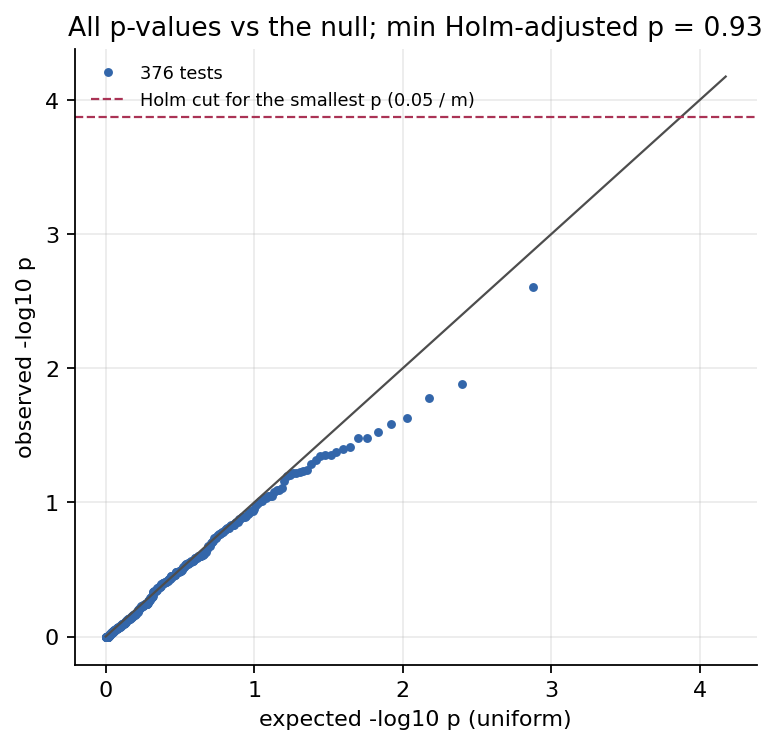
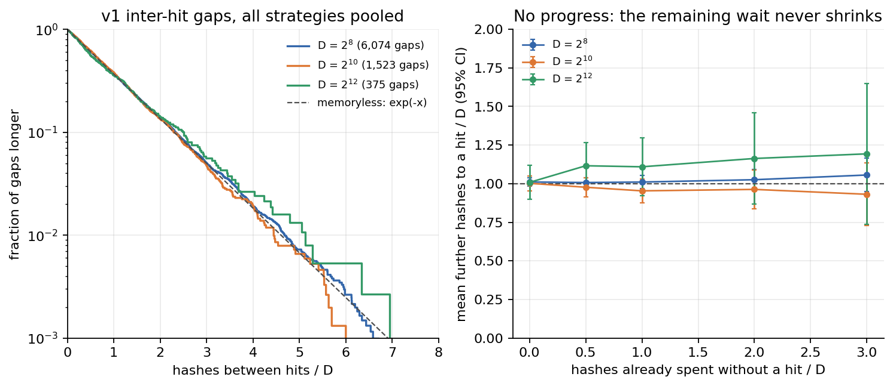

# Nonce strategies: can a smarter search beat brute force?

A RandomX miner varies a 32-bit nonce in the block hashing blob and hashes until the output meets the network difficulty. Many "novel mining algorithm" proposals assume that some nonce order, some nonce structure, or some pattern in the outputs finds a qualifying hash sooner than blind trial. This experiment tests that assumption on real RandomX v1 and v2 outputs.

**Result: no.** 1,853,952 real RandomX hashes were computed: six nonce strategies with equal budgets, plus an avalanche set of one-bit nonce flips. The outcome:

- Every strategy finds difficulty-meeting hashes at the brute-force rate.
- No uniformity, independence, avalanche or learnability test detects structure in the outputs after multiple-testing correction.
- The wait to the next hit is memoryless.
- Across 376 tests, the smallest Holm-adjusted p-value is 0.93, and no test rejects the null at 0.05.

A block costs D hashes on average whatever the search order, and no amount of elapsed work counts as progress toward it. The only lever is hashes per second (and per joule).

| Component | File |
|---|---|
| Experiment: nonce sequences, hashing, checkpointing, analysis, figures | [experiments/nonce_strategies.py](../experiments/nonce_strategies.py) |
| Difficulty semantics and the statistical test battery (no dependency on the binding) | [rxlab/analysis/uniformity.py](../rxlab/analysis/uniformity.py) |
| Difficulty checks against mainnet blocks, test calibration, experiment layout | [tests/test_uniformity.py](../tests/test_uniformity.py) |
| Every number in this document | [results/nonce_strategies.json](../results/nonce_strategies.json) |
| Figures | `figures/nonce_*.png` (six, shown below) |

JSON key paths are given in backticks, relative to `versions.<v1|v2>` unless they start with `holm` or `setup`.

## Setup

### Input and difficulty rule

| Item | Value |
|---|---|
| Library | RandomX v2.0.1 (`third_party/randomx-v2.0.1`). One build computes both versions; `Flags.V2` selects v2. |
| Mode | Fast mode (2080 MiB dataset, initialised with 4 threads), JIT, hardware AES, W^X secure JIT (macOS arm64) |
| Key | `b"test key 001"` |
| Input | The 76-byte Monero block hashing blob of official test vector 1e |
| Nonce | 4 bytes, little-endian, at byte offset 39 (zero in the vector) |
| Hashing | 4 threads, one VM per thread, `VM.hash_many` |

Because the vector's nonce bytes are zero, nonce 0 must reproduce the official hash. The run checks this for both versions before hashing and again at analysis time.

One dataset serves both versions. RandomX v2 changes only the VM (program size, CFROUND, AES mixing, prefetch distance), and the v1 and v2 VMs built on the same dataset both reproduce their official vector-1e hashes.

**Difficulty.** Monero's `check_hash` reads the 32-byte hash as a little-endian 256-bit integer and accepts it when `hash * D < 2^256`. For D = 2^k this is exactly "at least k leading zero bits, counted from the most significant bit of byte 31". `meets_difficulty` implements the big-integer rule, and `leading_zero_bits` computes the vectorised equivalent. The tests assert that the two agree. The thresholds tested are D = 2^8 through 2^16. A *hit* at D is a hash that meets difficulty D.

### Strategies

The seed is 1009, and random nonce sets come from `numpy.random.default_rng([1009, version index])`.

| Strategy | Nonce sequence, in search order |
|---|---|
| `sequential` | 0, 1, 2, ... |
| `sequential_random_start` | s, s+1, ... (mod 2^32) from a random 32-bit s |
| `uniform_random` | Uniform 32-bit nonces, without replacement |
| `strided_65536` | 2^16 pool-style partitions of 2^16 nonces, visited round-robin: nonce = (i mod 2^16)·2^16 + ⌊i / 2^16⌋ |
| `gray_code` | Binary-reflected Gray code i ^ (i >> 1) inside a random aligned block; consecutive nonces differ in one bit |
| `low_hamming_weight` | Nonces by increasing popcount, ascending within a popcount (Gosper's hack) |

### Budgets

| | v1 | v2 |
|---|---|---|
| Hashes per strategy | 2^18 = 262,144 | 2^15 = 32,768 |
| Avalanche set: random base nonces, each followed by its 32 one-bit flips | 2,048 bases | 512 bases |
| Hashes computed | 1,640,448 | 213,504 |
| Distinct nonces hashed | 1,596,517 | 210,028 |
| Tests entered into the Holm family | 188 | 188 |

v1 carries the main budget. v2 is a lower-power replication with an 8× smaller per-strategy budget.

### Overlap between strategies

The strategies are not disjoint. In v1, `low_hamming_weight` shares its low-popcount nonces with `sequential` (every such nonce below 2^18) and with `strided_65536`, which at 2^18 hashes touches the four lowest nonces of every 2^16 partition. 43,797 of its 262,144 nonces had already been hashed by a strategy earlier in the table, and every other strategy overlaps by at most 54 (`overlap_with_earlier_strategies`; v2: 3,471 and at most 2). The analysis handles the overlap test by test:

- Per-strategy tests use each strategy's full sequence, which is what a miner running it would see.
- The homogeneity test across strategies uses only nonces that no earlier strategy in table order had hashed, so its groups are disjoint.
- Pooled tests (bytes, bits, leading zeros, learnability) deduplicate by nonce across all sets, the avalanche set included.
- Hashes of repeated nonces are compared at analysis time. Any mismatch aborts the run.

### Storage and determinism

Each checkpoint chunk of 4,096 hashes stores `nonce` (uint32) and the full 32-byte `hash`, which comes to 36 bytes per hash and about 65 MB for the whole run. Chunks live under `data/cache/nonce_strategies/<version>/<set>/<chunk>.npz`, which is excluded from version control. Full hashes are kept because the avalanche matrix and the byte tests need all 256 bits.

A chunk is reused only if its stored nonces equal the planned ones, so changing a strategy invalidates exactly the affected chunks. Chunks are written to a temporary name and then renamed, so a killed run never leaves a torn chunk.

The run is deterministic. Seeds are fixed, there are no timestamps, and floats in the JSON are rounded to 6 significant digits so that BLAS rounding differences do not appear as diffs. Hash rates appear only in the log, never in the results, because the machine was loaded during the run. Every result is a count or a test statistic, so the hardware (Apple M4, macOS arm64) does not enter them.

## Test battery

Every test is implemented in [uniformity.py](../rxlab/analysis/uniformity.py).

| Family | Test | Null reference | Tests per version |
|---|---|---|---|
| Hit counts | Exact two-sided binomial test with a Clopper-Pearson 95% CI, per strategy and D | Binomial(n, 1/D) | 54 |
| Homogeneity | Pearson chi-square on the hits/misses table across strategies, disjoint nonces only. Uses the exact conditional null (multivariate hypergeometric, 100,000 seeded draws) when any expected hit count is below 5. | chi2(5) | 9 |
| Leading zero bits | Chi-square, adjacent cells merged until each expects at least 5; six strategies plus the deduplicated pool | P(lz = j) = 2^-(j+1) | 7 |
| Byte uniformity | Chi-square per byte position, and summed over all 32 positions | chi2(255); chi2(8160) | 33 |
| Bit balance | Sum of z² of the ones count per output bit | chi2(256) | 1 |
| Serial correlation | Pearson r between hash/2^256 at nonce lags 1 to 4, for `sequential` and `sequential_random_start` | r = 0 | 8 |
| Adjacent Hamming distance | Distance between hashes of consecutive nonces in search order: chi-square fit and z-test of the mean, for `sequential`, `sequential_random_start` and `gray_code` | Binomial(256, 1/2) | 6 |
| Avalanche | Hamming distance after flipping each of the 32 nonce bits: fit and mean z-test | Binomial(256, 1/2) | 64 |
| Strict avalanche | 32 × 256 output-bit flip counts, sum of z² over all 8,192 cells | chi2(8192) | 1 |
| Learnability | Ridge logistic regression on the 32 nonce bits; out-of-sample AUC with a Mann-Whitney p-value | AUC = 0.5 | 2 |
| Inter-hit gaps | Chi-square on up to 20 near-equiprobable bins, for D = 2^8, 2^10 and 2^12 | Geometric(1/D) | 3 |

Design choices behind the battery:

- **Exact tests where counts are small.** At D = 2^16 only 4 hits per strategy are expected in v1, and 0.5 in v2, so chi-square approximations would be unreliable. That is why hit counts use exact binomial tests and homogeneity falls back to the exact conditional null.
- **One Holm family for everything.** All 376 p-values from both versions are adjusted together. Holm's step-down procedure controls the family-wise error rate under any dependence, which matters here because the tests are dependent: thresholds are nested, and per-strategy and pooled tests reuse the same data.
- **Learnability is scored out of sample.** The model is fit by Newton-Raphson with l2 = 1 on the slopes and an unpenalised intercept. It is trained on a random half of the deduplicated hashes and scored by AUC on the other half. The targets are D = 2 (top bit zero, balanced classes) and D = 2^8. `auc_se_under_null` is the Hanley-McNeil standard error. The Mann-Whitney p-value is valid because the model is scored only on held-out data.
- **Memorylessness is tested directly.** For D = 2^8, 2^10 and 2^12, the gaps (in hashes) between successive hits in each strategy's own search order are pooled across strategies and tested against Geometric(1/D). The pool includes the wait from the start to the first hit. The mean remaining wait E[G − m | G > m] is reported for m = 0, 0.5D, D, 2D and 3D. For a memoryless search it stays at D.

## Results

### Headline statistics by test family

| Family | v1 (2^18 per strategy) | v2 (2^15 per strategy) |
|---|---|---|
| Hit counts, smallest per-strategy p (`hit_counts`) | 0.033 (`gray_code`, D = 2^13) | 0.017 (`sequential`, D = 2^14: 6 hits, 2 expected) |
| Homogeneity across strategies, D = 2^8 to 2^16 (`homogeneity_exclusive_nonces`) | p = 0.25 to 0.98 | p = 0.11 to 0.62 |
| Leading zero bits, pooled (`leading_zero_bits.pooled_unique`) | mean 0.99983 (1 expected); 13.83 on 18 df, p = 0.74 | mean 1.00499; 15.32 on 15 df, p = 0.43 |
| Leading zero bits, per strategy | p = 0.40 to 0.93 | p = 0.062 to 0.95 |
| Bytes, joint (`byte_uniformity`) | 7,987.8 on 8,160 df, p = 0.91 | 8,198.5 on 8,160 df, p = 0.38 |
| Bytes, smallest per-position p | 0.0025 (byte 12) | 0.013 (byte 10) |
| Bit balance (`bit_balance`) | 251.4 on 256 df, p = 0.57, max \|z\| = 2.73 | 265.6 on 256 df, p = 0.33, max \|z\| = 2.75 |
| Serial Pearson r, lags 1 to 4 (`serial`) | max \|r\| = 0.0044, smallest p = 0.023 | max \|r\| = 0.0035, smallest p = 0.52 |
| Adjacent Hamming distance, mean (`sequential` / `sequential_random_start` / `gray_code`) | 127.995 / 127.997 / 128.034 | 127.975 / 127.990 / 127.962 |
| Avalanche, mean distance per flipped nonce bit (`avalanche.per_nonce_bit`) | 127.67 to 128.33; smallest fit p 0.098, smallest mean p 0.058 | 127.21 to 128.58; smallest fit p 0.048, smallest mean p 0.026 |
| Strict avalanche matrix (`avalanche.strict_avalanche`) | 8,204 on 8,192 df, p = 0.46, max \|z\| = 4.24 | 8,114 on 8,192 df, p = 0.73, max \|z\| = 3.71 |
| Learnability, D = 2 (`learnability`) | AUC 0.4998, null SE 0.0006, p = 0.79 | AUC 0.5017, null SE 0.0018, p = 0.35 |
| Learnability, D = 2^8 | AUC 0.4965, null SE 0.0052, p = 0.50 | AUC 0.5027, null SE 0.0137, p = 0.84 |
| Inter-hit gaps vs geometric, D = 2^8 / 2^10 / 2^12 (`inter_hit_gaps`) | p = 0.97 / 0.58 / 0.83 | p = 0.43 / 0.42 / 0.44 |

### Hit counts

At D = 2^8, 1,024 hits per strategy are expected in v1 and 128 in v2. At D = 2^16, 4 hits are expected in v1.

| Strategy | v1 hits, D = 2^8 | hits / expected | exact 95% CI | exact p | v1 hits, D = 2^16 | v2 hits, D = 2^8 |
|---|---|---|---|---|---|---|
| `sequential` | 1019 | 0.995 | 0.935 to 1.058 | 0.89 | 3 | 133 |
| `sequential_random_start` | 975 | 0.952 | 0.893 to 1.014 | 0.13 | 2 | 122 |
| `uniform_random` | 1057 | 1.032 | 0.971 to 1.096 | 0.30 | 4 | 129 |
| `strided_65536` | 1049 | 1.024 | 0.963 to 1.088 | 0.43 | 3 | 139 |
| `gray_code` | 994 | 0.971 | 0.911 to 1.033 | 0.36 | 3 | 117 |
| `low_hamming_weight` | 980 | 0.957 | 0.898 to 1.019 | 0.17 | 2 | 140 |

At D = 2^8 the per-strategy 95% interval on hits / expected is roughly ±6%. At D = 2^16 it widens to 0.27 to 2.56 for 4 observed hits (`uniform_random`). The homogeneity test at D = 2^16 uses the exact conditional Monte Carlo null in v1, and in v2 it does so from D = 2^13 upward. The smallest per-strategy binomial p in either version is 0.017: v2 `sequential` at D = 2^14 found 6 hits where 2 were expected, and its Holm-adjusted p is 1.


*Hits / (hashes / D) with exact 95% CIs for each strategy and difficulty. The y-axis is clipped at 3. At high D some v2 intervals, and the v2 point estimates of 4 at D = 2^16, lie beyond it.*

### Output distribution

Leading zero bits follow the fair-coin geometric law. The deepest v1 hash had 23 leading zero bits. Byte frequencies at all 32 positions and the balance of all 256 output bits are consistent with uniform output. The smallest per-byte p, 0.0025 at v1 byte 12, is also the smallest raw p in the whole family, and its Holm-adjusted value is 0.93.





### Neighbouring nonces

For lags 1 to 4, the Pearson r between hash(n)/2^256 and hash(n + lag)/2^256 satisfies |r| ≤ 0.0044 over about 262k pairs per lag in v1. The smallest p is 0.023 (`sequential`, lag 4; Holm p = 1).

Adjacent Hamming distances match Binomial(256, 1/2), which predicts mean 128 and SD 8. For `sequential` the mean is 127.995 (SD 7.99), and for `sequential_random_start` it is 127.997 (SD 8.01). Consecutive Gray-code nonces, which differ in exactly one bit, give 128.034 (raw p = 0.030, Holm p = 1).

### Avalanche

Flipping any single nonce bit changes about half the output bits. With 2,048 random bases per flipped bit in v1, all 32 mean distances fall inside the 95% band for a Binomial(256, 1/2) mean. The strict avalanche matrix checks every (nonce bit, output bit) pair for a flip rate of 1/2. Its largest cell |z| is 4.24 across 8,192 cells, and the joint statistic is 8,204 on 8,192 df (p = 0.46).

Under the null the cells for one base are pairwise independent, since each is an XOR of independent uniform bits, so chi2(8192) is the correct reference.



### Learnability

A ridge logistic model on the 32 nonce bits cannot predict a hit. For D = 2, the model was trained on 798,258 hashes and tested on 798,259. Its out-of-sample AUC is 0.4998, with a null SE of 0.00065, and its largest fitted coefficient is 0.012. The 95% interval therefore puts a linear nonce-bit model within ±0.0013 AUC of a coin flip. For D = 2^8, with 3,088 positives in the test half, the AUC is 0.4965 (SE 0.0052, p = 0.50).

### Multiple testing

`holm` contains 376 tests, 188 per version, with the following summary:

| Quantity | Value |
|---|---|
| Raw p < 0.05 | 15 |
| `holm.expected_raw_below_0.05_under_null` | 18.8 (an upper bound; see below) |
| Smallest raw p | 0.0025 (v1 byte position 12) |
| Smallest Holm-adjusted p | 0.93 (same test) |
| Rejections at 0.05 | 0 |

The value 18.8 is 5% of 376. It is an upper bound on the expected count rather than the expectation itself, because many tests are discrete and conservative. For example, several are exact binomial tests with only a handful of expected hits. Fewer than 18.8 raw rejections is therefore the normal outcome under the null. The p-value QQ plot follows the diagonal and falls below it in the tail, where there are fewer very small p-values than a uniform null would give. Every point lies well below the Holm cut.



### Memorylessness: why no search order can help

The table below pools v1 gaps between successive hits, measured in each strategy's own search order (`inter_hit_gaps`).

| D | Gaps | Mean gap | Geometric fit p | Mean remaining wait after 0, D/2, D, 2D, 3D hashes without a hit | SE range |
|---|---|---|---|---|---|
| 2^8 = 256 | 6,074 | 258.8 | 0.97 | 258.8, 257.9, 258.7, 262.5, 270.3 | 3.3 to 14.1 |
| 2^10 = 1024 | 1,523 | 1026.6 | 0.58 | 1026.6, 1000.1, 976.3, 985.9, 953.5 | 25 to 106 |
| 2^12 = 4096 | 375 | 4130 | 0.83 | 4130, 4571, 4543, 4764, 4887 | 229 to 953 |

A miner who has already spent 3D hashes without a hit still faces about D more on average, the same as a miner who has just started. Every v1 residual wait lies within about 1.5 SE of D. At D = 2^8, the per-strategy mean hashes per hit range from 0.97D to 1.05D. The v2 residual waits beyond D rest on too few gaps to cite; see [Known limitations](#known-limitations-and-open-questions).



*Left: the fraction of v1 gaps longer than x·D, against the memoryless curve exp(−x). Right: the mean further hashes to a hit, in units of D, after a given number of hashes without one, with 95% CIs.*

**Implication.** The expected cost of a block is D hashes regardless of strategy, and elapsed work buys no progress. A nonce strategy could help only if RandomX output had structure that is exploitable from the nonce. The byte, bit, serial, avalanche and learnability tests find none above their detection limits. What remains is throughput, hashes per second and per joule, which the benchmark experiments in this repo (`experiments/bench_*.py`) measure.

## Validation

- **Official vector.** Nonce 0 of `sequential` reproduces the official vector-1e hashes for v1 (`c56414...cd5f1`) and v2 (`c8e92c...f6e76`), both at hash time and at analysis time (`golden_nonce0_hash`). The key, blob and both hashes appear verbatim in the upstream `src/tests/tests.cpp` (the `calcHexHash("test key 001", "0b0b98...")` case). `test_experiment_blob_is_official_vector_1e` asserts that the experiment's constants equal the vector table in [tests/test_binding_vectors.py](../tests/test_binding_vectors.py).
- **Real Monero mainnet blocks.** `test_real_monero_blocks_meet_difficulty_little_endian` checks the difficulty rule against the chain.
  - A public node's restricted RPC returns an empty `pow_hash`, so the hashing blobs are rebuilt from header fields. For coinbase-only blocks the transaction Merkle root is just the miner-transaction hash, so no Keccak implementation is needed. Of the blocks at heights 3,000,000 to 3,000,099, seven had no transactions.
  - The test uses blocks 3,000,002 and 3,000,005. Each blob is 76 bytes with the header nonce at offset 39. The RandomX v1 key is the hash of seed block 2,998,272 = (height − 65) & ~2047.
  - The resulting hash meets the block's difficulty (about 2^38.2) when read little-endian and fails when read big-endian. Every header field in the test and the seed hash were cross-checked against the chain.
  - The test validates itself: with a wrong field or seed, the chance of still meeting a difficulty near 2^38 is about 2^-38.
- **Cached hashes are real RandomX outputs.** A separate check script, which is not included in the repository, recomputed 725 cached hashes through a different code path: light mode and the one-shot `VM.hash`, instead of fast mode and `hash_many`. The sample was every cached hash with at least 12 leading zero bits in both versions, plus 20 random hashes from each of the 14 (version, set) directories. All 725 matched. For each one, the big-integer `meets_difficulty(h, 2^k)` also agreed with the leading-zero count for k = 8 to 16. Separately, `test_experiment_hashes_match_single_hash_api` checks that the experiment's blob builder plus batch hashing equals one-shot hashing.
- **Calibration of every statistical test.** In [tests/test_uniformity.py](../tests/test_uniformity.py), seeded uniform data must pass (p > 1e-3), and a planted bias of the matching kind must fail, mostly at p < 1e-6. The exceptions are the small-count exact homogeneity null (p < 1e-3), the bit-balance `max_abs_z` check (> 5) and the learnability check, which requires an out-of-sample AUC between 0.47 and 0.53 on noise and above 0.7 on a planted nonce-bit signal. The chi-square, binomial and contingency results are checked against `scipy.stats`, and Holm is checked against a textbook example. The file has 22 test functions, one of them parametrised over five difficulties, for 26 test cases.
- **Method checks against the code.**
  - The hit probability for D = 2^k is exactly 2^-k.
  - The leading-zero pmf sums to 1.
  - The gap-test bin edges and probabilities line up with `searchsorted(side="left")`.
  - The homogeneity groups are disjoint.
- **Reproducibility.** Rerunning `--analyse-only` in a fresh process, which does no hashing, reproduced `results/nonce_strategies.json` and all six figures byte for byte. The conditions for this are listed under [Known limitations](#known-limitations-and-open-questions).

## Reproducing

```sh
bash scripts/build_randomx.sh v2.0.1                    # build the reference library into third_party/
python3 experiments/nonce_strategies.py                 # hash (resumable from data/cache/), then analyse
python3 experiments/nonce_strategies.py --analyse-only  # rerun the analysis from cached hashes only
python3 experiments/nonce_strategies.py --smoke         # tiny budgets; all outputs stay under data/cache/
python3 -m pytest tests/test_uniformity.py
```

`--threads` sets the number of hashing threads (default 4). Fast mode needs the 2080 MiB dataset resident in RAM. `--analyse-only` on an empty cache fails with a `FileNotFoundError` that names the missing chunk. The code has no absolute paths and targets Python ≥ 3.9. The recorded run used Python 3.9.6, and exact reproduction needs NumPy 2.0.2 (see below).

## Development notes

- **Slow exact Mann-Whitney test.** The smoke sample had a tiny positive class (15 positives at D = 2^8), and `scipy.stats.mannwhitneyu` with its default `method="auto"` switches to the exact null distribution when one sample has at most 8 elements and there are no ties. That exact computation dominated the analysis: cProfile attributed 58 s of a 113 s smoke run to it (measured on a loaded machine; not a benchmark result). The fix forces `method="asymptotic"`, which is accurate at the full run's positive counts (at D = 2^8, 3,088 test-half positives in v1 and 443 in v2).
- **Spurious floating-point warnings in the logistic fit.** The fit emitted "divide by zero / overflow encountered in matmul". The same warnings appear for a plain 1000 × 33 random matrix product under `-W error`: NumPy 2.0.2 on macOS Accelerate raises spurious FP flags. The fix silences them only inside the fit and adds a finiteness check on the weights. It also switches to a ridge penalty (l2 = 1, intercept unpenalised), so that a small, separable smoke sample cannot diverge.
- **Bugs in the tests themselves.** An unsigned `unpackbits(...).sum()` underflowed, and `POPCOUNT8` was indexed with 32-bit XORs. Both were fixed.
- **A wrong power expectation.** The joint 256-bit balance test does not reach p < 1e-6 for a single-bit bias affecting 1% of 200k hashes (p = 1.1e-5, the statistic diluted over 256 df), whereas the targeted leading-zero test does. The calibration now checks each kind of bias with the test designed for it: a 1% bias (top bit cleared in 2% of rows) for the targeted test and a 5% bias (top bit cleared in 10% of rows) for the joint tests. The p-value thresholds were not relaxed.
- **A thin calibration margin.** For the 1% planted bias, the bit-balance `max_abs_z` assertion originally required > 8, while the expected value is about 8.9 ± 1 (9.16 at seed 3). It now requires > 5, which leaves a wide margin if the RNG stream changes.
- **Memory pressure during the full run.** After 917,504 of 1,853,952 hashes, four processes each held their own 2 GB RandomX dataset and the machine went into heavy swap. The resident size of the experiment process fell from 1.95 GB to 1.63 GB, meaning dataset pages were being swapped out. Because RandomX reads the dataset at random, the hash rate collapsed from about 1,100 to about 150 per second (measured on a loaded machine; not a benchmark result). The run was stopped, keeping 224 finished chunks, and resumed from the checkpoint once memory was free. The golden-hash and duplicate-nonce consistency checks passed in both versions.
- **FP rounding mode left behind by the batch API.** The C batch API (`randomx_calculate_hash_first/next/last`) leaves CFROUND's rounding mode set in the calling thread. [rxlab/binding.py](../rxlab/binding.py) now saves and restores the FP environment in `hash_many`. The cached hashes were computed before this fix and are unaffected: they come from C, nonce 0 matches the official vector, and the 725-hash cross-check above passed. The statistics are unaffected too, because a fresh-process `--analyse-only` rerun reproduced the JSON byte for byte.
- **Figure fixes.** At high D with small budgets the hit-ratio bars dwarfed the plot, so the hit-rate panel now clips at 3× expectation and says so in its title. The legend moved below both panels because it covered the v2 error bars at D = 2^11 to 2^12. The avalanche legend moved clear of the points, and the serial band is drawn before the points. No statistic changed.

## Known limitations and open questions

- **Detection limits of the hit-count tests.** At 2^18 hashes per strategy, the per-strategy CI on hits / expected is about ±6% at D = 2^8 and spans roughly 0.3× to 2.6× at D = 2^16. A strategy with a 1% edge would be invisible to the hit-count tests. Any such edge would have to come from structure in the hash function, which the byte, avalanche, serial and learnability tests probe with far more data per test. Still, "no edge" means "no edge above these detection limits".
- **Linear-only learnability adversary.** Learnability used only a linear model on the 32 nonce bits. A nonlinear learner, such as one using pairwise bit products or gradient-boosted trees, would be a stronger adversary. None was run. Gradient-boosted trees need a dependency beyond those declared in [pyproject.toml](../pyproject.toml), or a hand-rolled implementation. Pairwise bit products would fit the existing ridge logistic code (`logistic_fit` takes any feature matrix) but were not tried.
- **Smaller v2 budget.** v2 used 2^15 hashes per strategy and 512 avalanche bases, 8× and 4× fewer than v1, so its tests have correspondingly less power.
- **Contiguous blocks for the sequential and Gray-code strategies.** `sequential`, `sequential_random_start` and `gray_code` each cover one contiguous block of nonces (2^18 in v1, 2^15 in v2). The Gray-code block is aligned and starts at 3,375,890,432 in v1. A strategy's hit count depends only on the set of nonces it tries, so the Gray-code hit counts are the same experiment as a sequential scan from another start. Order can affect only the time to a hit and serial structure, and those are tested separately through gaps and adjacent Hamming distance. The hit-count table therefore tests fewer distinct hypotheses than "six strategies" suggests.
- **Pooled gaps are not fully independent.** The pooled gap test includes `low_hamming_weight`, which re-hashes 43,797 nonces that earlier strategies had already hashed. Some hit indicators therefore appear twice, in different search orders. A sensitivity check that leaves this strategy out (its script is not included in the repository) does not change the conclusion. The JSON in `results/` reports the full pool.

  | Version | Geometric-fit p, D = 2^8 / 2^10 / 2^12 | Gaps | Residual waits |
  |---|---|---|---|
  | v1 | 0.99 / 0.31 / 0.71 | 5,094 / 1,271 / 314 | every z within ±1.4 |
  | v2 | 0.15 / 0.31 / 0.57 | not reported | not reported |
- **Do not cite v2 residual waits beyond D.** `residual_waits` reports an SE whenever at least two gaps remain. At D = 2^12, the v2 values at D, 2D and 3D rest on 16, 5 and 2 gaps. At 3D the JSON shows a mean of 1,569.5 with an "SE" of 471.5. That is a nominal z of −5.4 computed from two gaps, and it means nothing. The v1 figure drops only rows with n ≤ 1.
- **Other blob fields were not varied.** Miners also vary the timestamp, and the extra nonce (and therefore the Merkle root, via the coinbase). The same argument applies to any input byte, but only the 4-byte nonce was tested.
- **Byte-for-byte reproducibility has two conditions.**
  - `machine` comes from `sysinfo.describe()` at analysis time and includes `power_source`, so a rerun on a different power source changes that one field.
  - The random nonce sets come from `numpy.random.default_rng`, and NumPy does not promise stable `Generator` streams across versions. A different NumPy version may plan different nonces. The checkpoint check catches this and re-hashes, but the JSON will then differ. Use NumPy 2.0.2 for an exact reproduction.
