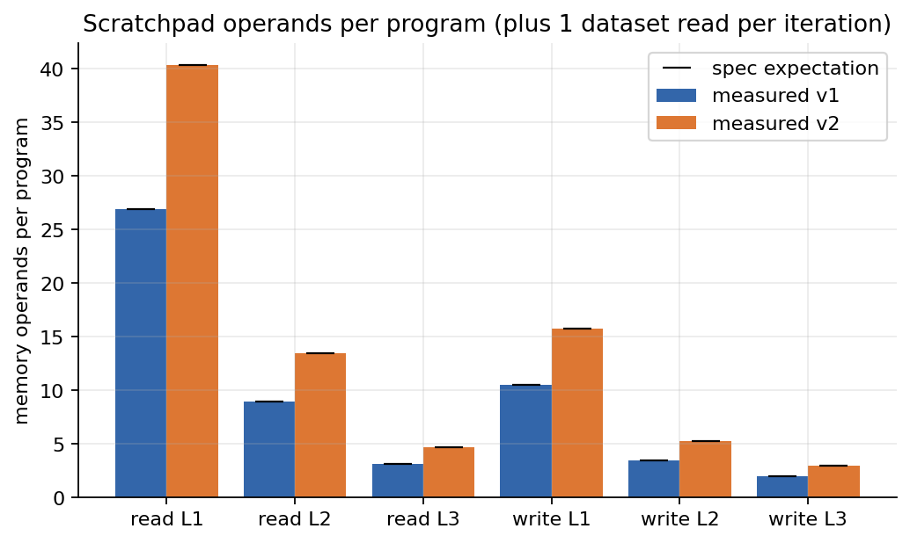
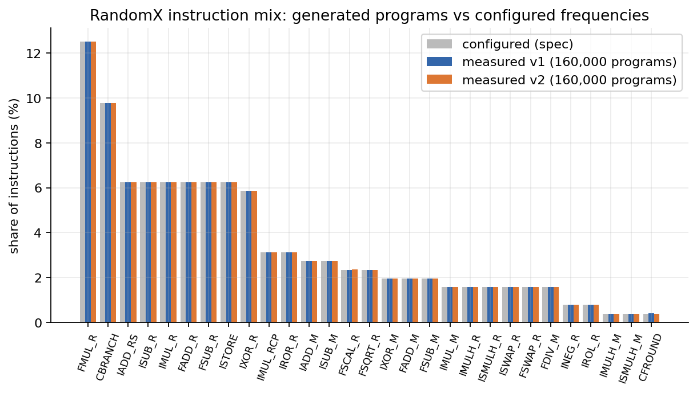
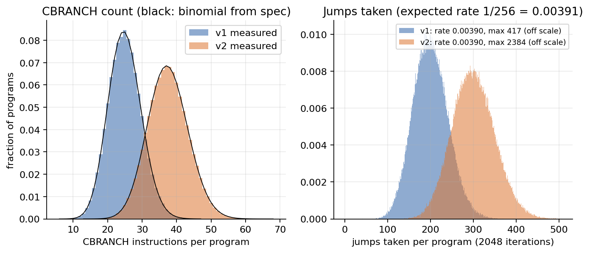
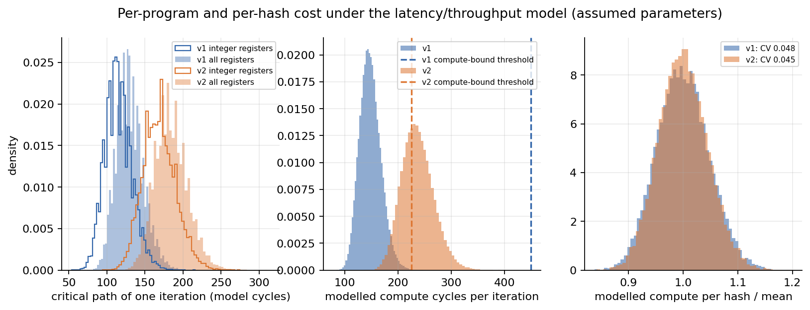

# Program structure

This page answers two questions.

1. What is inside a RandomX program, in v1 and v2? Which of its properties defeat
   the usual shortcut ideas: early reject, program skipping, result caching,
   precomputation and GPU-style batching?
2. Hash cost varies from nonce to nonce, and program 0 is known before the hash is
   run. Can a miner skip the expensive nonces and come out ahead?

The first question is answered by a survey of 20,000 inputs (160,000 programs) per
version. The survey uses the reference library's own generator, compiler and
interpreter, and it measures no time. The second question is answered by an
experiment, [`experiments/nonce_cost.py`](../experiments/nonce_cost.py). This page
describes the experiment and the cost-model prediction it is tested against. Its
measured results are reported in `FINDINGS.md`.

## Summary

- **The generator is exactly as specified.** Instruction mix, memory-operand
  levels, CBRANCH counts and effective NOPs all match the spec's expectations.
  The instruction-mix χ² gives p = 0.11 for v1 and p = 0.35 for v2.
- **Work per hash is constant.** Branches add only 0.24% to the number of
  instruction slots executed per hash, and that number varies with a CV of 0.016%
  (v1) and 0.014% (v2). Dynamic instruction count cannot tell cheap nonces from
  expensive ones.
- **The 8 programs of a hash are independent.** Adjacent programs' modelled compute
  correlates at r = 0.0014 (v1) and 0.0021 (v2). The per-hash CV is the
  per-program CV × 0.355 (v1) and 0.354 (v2), against 1/√8 = 0.354. Program 0
  carries 12.3% (v1) and 12.6% (v2) of the per-hash compute variance.
- **Nothing repeats and nothing batches.** No two programs are identical among
  160,000 per version. A 32-wide warp of random programs sees 16.16 (v1) and
  16.14 (v2) distinct instruction types per slot. 95.6% (v1) and 99.1% (v2) of
  warp-iterations contain at least one taken branch.
- **Skipping nonces gains very little, even in the model.** The cost model has
  assumed, uncalibrated parameters. Under it, a perfect and free program-0 filter
  that skips q = 1% / 10% / 50% of nonces gains +0.013% / +0.086% / +0.33% in v1
  and +0.048% / +0.31% / +1.02% in v2. That is before charging for the 2 MiB
  scratchpad fill that every skipped nonce still costs.

## Components

| file | role |
|---|---|
| [`tools/progdump.cpp`](../tools/progdump.cpp), [`tools/build_progdump.sh`](../tools/build_progdump.sh) | C++ probe, statically linked against the RandomX v2.0.1 object files. It replays `randomx_calculate_hash` with the library's own code and writes one CSV row per program: static features, dynamic counters and the final hash. `--bench-prefix` times, in C, what it costs to derive program 0 and its features. |
| [`rxlab/analysis/programs.py`](../rxlab/analysis/programs.py) | Runs progdump and caches its CSV in `data/cache/`. Also holds a reference decoder written only from the spec (`reference_features`), the spec expectations (`expected_counts`), the cost model (`uops`, `cost_model`) and the skipping arithmetic (`skip_gain`, `cv_predict`). |
| [`experiments/program_structure.py`](../experiments/program_structure.py) | Runs the survey. It runs progdump in fast mode over nonces 0 to N−1 of test vector 1e, for v1 and v2, and writes [`results/program_structure.json`](../results/program_structure.json) and `figures/program_{mix,memory,cbranch,cost}.png`. |
| [`experiments/nonce_cost.py`](../experiments/nonce_cost.py) | Runs the nonce cherry-picking experiment (see [below](#nonce-cherry-picking-experiment)). |
| [`tests/test_programs.py`](../tests/test_programs.py) | 13 tests, one of them marked `slow` (see [Validation](#validation)). |

### progdump

progdump subclasses `VmBase<AlignedAllocator<CacheLineSize>, false>` and `BytecodeMachine`, so
the library supplies all of the following:

- program generation (`VmBase::generateProgram`);
- VM configuration (`randomx_vm::initialize`);
- decoding (`BytecodeMachine::compileProgram`: memory masks, effective NOPs, branch
  targets);
- the semantics of every instruction (`executeInstruction`).

The only copied code is the loop of `InterpretedVm::execute()`, with counters
added. `hashAndDump` follows `randomx_calculate_hash` step by step: Blake2b seed,
`initScratchpad` (AES fill), eight rounds of program generation and execution, and
the final result.

Each CSV row holds:

- **Static features, from the library's bytecode.** Instruction counts for all 30
  types. Effective NOPs. Scratchpad reads and writes by level. Floating-point
  operand reads. Immediate sources (ISUB_R, IMUL_R, IXOR_R, IROR_R and IROL_R with
  src = dst, which use `imm32` in place of a register). CBRANCH jump-back body lengths
  (total and maximum). Three critical paths of one iteration: unit latency, model
  latency over all registers, and model latency over integer registers only.
- **A fingerprint.** A 64-bit FNV-1a hash of the raw program: the 128-byte
  configuration plus 8 bytes per instruction.
- **Dynamic counters, exact over 2,048 iterations.** Executed instruction slots,
  including CBRANCH re-executions. CBRANCH executions and jumps taken. CFROUND
  executions. `fprc` writes and actual rounding-mode changes. Dataset reads.
- **The raw program as hex, optionally.** Only for the first `--raw-limit` inputs,
  because the SIMT analysis needs per-slot opcodes and full raw dumps would dominate
  the file size.

The critical-path recurrence runs in C on the library's bytecode. Its latency table
comes in on the command line (`--latency`, 15 integers) from `programs.LATENCY`. The
model parameters therefore live in one place, and the C cost of the feature pass is
real. Opcode-to-type lookup uses a 256-entry table, as a real miner's would.

The build uses `-march=armv8-a+crypto` on arm64, never `-march=native`, because
Apple clang's native target drops the crypto extension. Library headers are
included with `-isystem`. The object files come from
`third_party/build-v2.0.1/CMakeFiles/randomx.dir/src/`, which
[`scripts/build_randomx.sh`](../scripts/build_randomx.sh) produces. v2.0.1 computes
both v1 and v2 hashes.

### Validation

- **Official hashes.** progdump reproduces all 10 official hashes: 5 vectors from
  [`tests/test_binding_vectors.py`](../tests/test_binding_vectors.py), each for v1
  and v2. Those values appear verbatim in the library's `src/tests/tests.cpp`.
- **Independent decoder.** A Python decoder written only from the spec reproduces
  every static feature of all 80 programs of those vectors. The features covered
  are memory levels, the CBRANCH target rule, effective NOPs, the three
  critical-path columns and all counts.
- **Fast mode.** Every survey run re-checks 16 fast-mode hashes per version against
  the library's own VM (light mode, JIT). The result was 16/16 for both versions.
- **Dynamic-counter invariants**, checked in the tests:
  - dataset reads = 2,048 per program;
  - slots executed exceed 2,048 × size if and only if at least one jump was taken;
  - CBRANCH executions = 2,048 × static CBRANCH count + jumps, exactly. This also
    holds for all 320,000 programs in the survey CSVs.
  - `fprc` writes = CFROUND executions in v1, and ≤ CFROUND executions in v2.
- **Spec arithmetic.** The frequency table's group totals match spec Table 5.1.1:
  integer 120, floating point 94, control 26, store 16. Expected operand counts and
  `skip_gain` are checked against values computed by hand. The cost model's output
  is checked against the memory-floor recurrence and its bounds. A leakage test on
  `cv_predict` confirms that pure noise gets R² < 0.01 out of fold.
- **Code reading.** The code was compared against the library:
  - `ProbeVm::execute` matches `InterpretedVm::execute` (v2.0.1
    `vm_interpreted.cpp`) line by line. The only differences are the counters and
    a prefetch that light mode skips.
  - The CFROUND counter uses the same rotate and v2 filter as `exe_CFROUND`.
  - The CBRANCH body length uses the library's own `ibc.target`.
- **Determinism.** Rerunning the survey analysis from the cached CSVs reproduces
  the JSON byte for byte, apart from the `machine` block.

The Python and C critical-path recurrences implement the same reading of the
latency model. Their agreement validates the decoding, not the model.

## Survey setup

- **Input.** Official test vector 1e: a real Monero hashing blob with the nonce
  stored as 4 little-endian bytes at offset 39, and key `test key 001`. The survey
  uses nonces 0 to 19,999, which gives 20,000 inputs and 160,000 programs per
  version.
- **Mode.** Fast mode (2080 MiB dataset) with the bytecode interpreter, RandomX
  v2.0.1 for both versions.
- **Timing.** Nothing is timed, so machine load does not affect any number in this
  section. The machine block of the JSON records an Apple M4 (arm64).

## What is inside a program

### Size, mix and memory operands

| | v1 | v2 |
|---|---|---|
| instructions per program | 256 | 384 |
| program bytes (128 B configuration + 8 B per instruction) | 2,176 | 3,200 |
| instruction mix vs configured frequencies (29 non-NOP types) | χ² = 37.5, 28 dof, p = 0.11 | χ² = 30.4, 28 dof, p = 0.35 |
| largest relative deviation of any type's share | 0.42% | 0.29% |
| floating-point share (configured 94/256 = 36.72%) | 36.71% | 36.71% |
| effective NOPs per program (spec expectation) | 0.499 (0.5) | 0.751 (0.75) |
| scratchpad reads per program, L1 / L2 / L3 | 26.91 / 8.97 / 3.13 | 40.37 / 13.46 / 4.68 |
| spec expectation | 26.91 / 8.97 / 3.13 | 40.36 / 13.45 / 4.69 |
| of which floating-point operand reads (never L3) | 13.99 | 21.00 |
| ISTORE per program, L1 / L2 / L3 | 10.50 / 3.50 / 2.00 | 15.76 / 5.25 / 3.00 |
| dataset reads per iteration (counted) | 1.000 | 1.000 |
| dataset prefetch distance | 1 iteration | 2 iterations |

Effective NOPs are almost all ISWAP_R with src = dst. An IMUL_RCP with a zero or
power-of-two immediate is also a NOP, but it is vanishingly rare.

All L3 reads (3.13 in v1, 4.68 in v2) are integer memory operands with src = dst.
Those use an immediate address. Every other scratchpad read uses an address
derived from a register.



Every iteration also does a fixed amount of work (spec 4.6.2), independent of the
program:

- two 64-byte scratchpad reads: the integer registers, and the `f`/`e` registers;
- two 64-byte scratchpad writes;
- one dataset read and one dataset prefetch;
- in v1, an XOR of the F registers with the E registers;
- in v2, 16 AES rounds (`aesenc`/`aesdec`) that mix the F registers with the E
  registers, in place of v1's XOR.



### Branches (CBRANCH)

| | v1 | v2 |
|---|---|---|
| CBRANCH per program, mean ± sd (min–max) | 25.0 ± 4.76 (6–47) | 37.5 ± 5.82 (13–68) |
| spec expectation (binomial, 25/256 per slot) | 25.0 | 37.5 |
| jumps per executed CBRANCH | 0.003896 | 0.003896 |
| jumps per static CBRANCH slot per iteration | 0.003911 | 0.003911 |
| jumps per program over 2,048 iterations, mean (max) | 200.2 (417) | 300.5 (2,384) |
| programs with no jump taken | 0 | 0 |
| mean jump-back body (max), instructions | 6.21 (92) | 6.25 (110) |
| re-executed slots per iteration, measured / static expectation | 0.607 / 0.606 | 0.917 / 0.916 |
| executed slots per hash | 4,204,246: +0.24% over 8 × 2048 × 256; CV 0.016% | 6,306,480: +0.24% over 8 × 2048 × 384; CV 0.014% |
| dispersion of jumps per program (about 1 for independent jumps) | 1.019; 7 programs above z = 5 | 1.115; 11 programs above z = 5 |

Branches cost almost no extra work. The instruction count per hash is constant to
0.02%.

The per-execution jump rate, 0.003896, is not 1/256 within noise. With 3.2·10⁷
jumps (v1) and 4.8·10⁷ jumps (v2), it lies 15σ and 19σ below 1/256. The cause is
mechanical:

- **A jump re-executes only its own CBRANCH.** A CBRANCH counts as modifying every
  integer register, so a jump never lands before the instruction that follows the
  previous CBRANCH, and the re-executed body never contains another CBRANCH. In every
  program, therefore, executions = 2,048 × static count + jumps. The tests assert
  this.
- **The re-execution almost never jumps again.** It adds `cimm` to a register whose
  condition bits are now all zero. `cimm` has the lowest condition bit set, so the
  second test rarely passes. If re-executions never jumped, the per-execution rate
  would be 1/257 = 0.003891.

Per static slot the rate is 0.003911, which is 0.12% above 1/256 (about 7σ in v1
and 8σ in v2 under a binomial error). That fits rare second jumps, which the library
permits. The exact second-jump probability has not been derived.

The jump counts are slightly overdispersed. One v2 program took 2,384 jumps, 7.45×
its expected count. See [open questions](#known-limitations-and-open-questions).



### Rounding-mode changes (CFROUND)

| | v1 | v2 |
|---|---|---|
| CFROUND per program | 1.00 | 1.50 |
| `fprc` writes per iteration | 1.007 | 0.100 |
| actual rounding-mode changes per iteration | 0.753 | 0.074 |
| share of CFROUND executions that write `fprc` | 100% | 6.68% (nominal 1/16 = 6.25%) |

v2's filter lets a CFROUND take effect only when 4 bits of the rotated source are
zero. This cuts rounding-mode writes by an order of magnitude even though programs
are 1.5× longer. The pass rate of 6.68% against the nominal 6.25% is unexplained.

### Dependency structure

Critical path of one iteration: the longest register-dependency chain, with all
registers ready at the start of the iteration and memory dependencies ignored.

| | v1 | v2 |
|---|---|---|
| critical path, unit latency (dependency depth), mean ± sd (min–max) | 40.1 ± 4.1 (26–61) | 59.5 ± 5.1 (40–89) |
| instructions per dependency level | 6.44 | 6.49 |
| critical path, model latencies (cycles), mean ± sd | 130 ± 17.6 (CV 13.5%; p1 95, p99 176) | 184 ± 21.1 (CV 11.5%; p1 141, p99 239) |
| programs whose longest chain ends in a floating-point register | 83.8% | 84.2% |

There are about 6.4–6.5 instructions per dependency level, so the parallelism
RandomX is designed to exploit on wide out-of-order cores is present. The longest
chain usually ends in a floating-point register. The E registers are the
destinations of FMUL_R (the most frequent instruction, 32/256), FDIV_M and FSQRT_R,
and the last two carry the model's longest floating-point latencies (10 and 13
cycles).

### Rare instructions

The RandomX design document (`doc/design.md` section 1.2) considers an
implementation that drops support for some operations and executes only the
programs that avoid them. The rarest instructions, each configured at 1/256, are
the most favourable case for such a design. Programs that lack one of them are
common. Hashes are rare in which all 8 programs lack it:

| | v1 | v2 |
|---|---|---|
| programs without IMULH_M / ISMULH_M / CFROUND | 36.6% / 36.7% / 36.6% | 22.2% / 22.2% / 22.2% |
| hashes in which all 8 programs lack it | 0.035% / 0.04% / 0.015% | 0 / 0 / 0 of 20,000 |

## Cost model (assumed parameters, uncalibrated)

`programs.cost_model` turns each program's static features into modelled cycles
per iteration. **Every parameter is an assumption:** rough public figures for a
wide out-of-order core of the Apple M-series P-core or Zen 4 class. None was
measured on this machine, and the model has not been calibrated against measured
hash times. Treat everything in this section as a statement about the model.

| parameter | assumed value |
|---|---|
| latency: ALU / MUL / MULH / address generation | 1 / 3 / 3 / 2 cycles |
| load latency: L1 / L2 / L3 | 4 / 10 / 18 cycles |
| FADD / FMUL / FDIV / FSQRT | 3 / 4 / 10 / 13 cycles |
| FSWAP / FSCAL (xor) / int→float conversion / E-mask | 2 / 2 / 5 / 2 cycles |
| execution units per cycle | 6 ALU, 2 MUL, 3 load, 2 store, 4 FP, 2 branch |
| issue width / in-flight window | 8 µops / 600 µops |
| divider occupancy per FDIV_M or FSQRT_R | 2 cycles |
| penalties | 13 cycles per taken CBRANCH (mispredict); 10 cycles per `fprc` write |
| dataset latency | 450 cycles (~100 ns DRAM plus a page walk at ~4.4 GHz) |

**Compute per iteration** is the largest of three bounds, plus additive terms:

- **Throughput bound.** Approximate µop counts per resource class, based on the
  arm64 JIT's expansions, divided by the units per cycle. Also the total µops over
  the issue width, and the divider occupancy.
- **Integer chain.** The integer-register critical path, plus the scratchpad-address
  load that starts the next iteration (address generation + L3 load + ALU). Integer
  registers carry over from one iteration to the next.
- **Window bound.** The full critical path × total µops / 600. The F and E registers
  are reloaded every iteration, so their chains can overlap across iterations, up
  to the window size.
- **Additive terms.** Expected CBRANCH re-execution, misprediction, and `fprc` writes
  (v2 counts 1/16 of its CFROUNDs).

**Memory floor.** Two facts set the floor:

- The dataset line read at the end of iteration i is requested at the end of the
  compute of iteration i − d, where d = 1 in v1 and d = 2 in v2.
- Every register of iteration i+1 depends on that line.

In steady state, then, (d+1)·T − compute ≥ latency, which gives
T = max(compute, (compute + latency)/(d+1)). An iteration is compute-bound exactly
when compute ≥ latency/d, that is, above 450 cycles in v1 and 225 in v2.

| | v1 | v2 |
|---|---|---|
| mean bound, cycles: throughput / integer chain / window | 63.2 / 136.1 / 109.8 | 94.9 / 189.9 / 233.6 |
| binding bound | integer chain 96.3%, window 3.7%, throughput 0% | window 99.9%, integer chain 0.08%, throughput 0% |
| mean additive terms, cycles: re-execution / mispredict / `fprc` | 0.15 / 1.27 / 10.04 | 0.23 / 1.90 / 0.93 |
| compute cycles per iteration | 147.9 ± 19.9 (CV 13.4%; p1 107, p99 199) | 236.7 ± 29.9 (CV 12.6%) |
| memory floor, cycles | 298.9 ± 9.9 | 228.9 ± 10.0 |
| programs above the floor (compute-bound) | **0%** | **63.2%** |
| cycles per iteration, after the floor | 298.9 ± 9.9 (CV 3.3%) | 241.1 ± 24.5 (CV 10.2%) |
| per-hash CV, compute only | 4.8% | 4.5% |
| per-hash CV, after the floor | 1.2% | 3.6% |
| per-hash / per-program compute CV (1/√8 = 0.354) | 0.355 | 0.354 |
| adjacent-program correlation of compute | 0.0014 | 0.0021 |
| program 0's share of per-hash compute variance | 12.3% | 12.6% |

Read at face value, the model makes these claims:

- **v1 is latency-bound.** With these parameters, every v1 iteration is limited by
  dataset latency. Only part of that latency is exposed, however: time per
  iteration is (compute + latency)/2, so half of each program's compute variation
  still reaches hash time. The per-hash CV is 1.2%, against 4.8% for compute alone.
- **v2 is mostly compute-bound.** Its programs are heavy enough to be compute-bound
  in 63% of cases. This fits the stated purpose of v2's longer programs and deeper
  prefetch (`doc/design_v2.md`).
- **v2's CFROUND change saves cycles.** It removes about 9 of the ~10 cycles of
  rounding-mode writes per iteration (10.04 → 0.93).

Whether v1 really is latency-bound depends mostly on the assumed 450-cycle latency
(see [limitations](#known-limitations-and-open-questions)).



The right-hand panel shows per-hash compute before the memory floor, with
CV 0.048 (v1) and 0.045 (v2). The per-hash CVs after the floor, 1.2% and 3.6%, are
in `per_hash_cycles` in the JSON.

## Which property defeats which shortcut

| shortcut | defeated by | evidence from the survey |
|---|---|---|
| **Early reject**: abandon a hash once it looks like a loser | The only value compared with the target is R = Hash256 of the register file after the 8th program, with AesHash1R of the 2 MiB scratchpad in its last 64 bytes (spec section 2). There is no partial result to test before the last program ends, and every nonce has the same win probability. | Nothing to measure structurally. Output uniformity is tested separately ([`experiments/nonce_strategies.py`](../experiments/nonce_strategies.py)). The only information available early is about *cost*, which is what the nonce cherry-picking experiment tests. |
| **Program skipping**: run only the cheap programs of a chain | Program j+1 is generated by AesGenerator4R, seeded with Hash512 of the register file after program j. Skipping or approximating any program changes every later program and the result. | Program costs are independent: adjacent correlation 0.0014 / 0.0021, and per-hash CV = per-program CV × 0.355 / 0.354. After program 0 runs, its cost is sunk. The design document's Appendix A works through the arithmetic for N = 8. |
| **Result caching or memoisation** | A program is 2,176 (v1) or 3,200 (v2) bytes of AES output from a 512-bit seed. Even identical code would act on a nonce-specific 2 MiB scratchpad and register file. | 0 duplicate programs among 160,000 per version (FNV-1a 64-bit fingerprints). Two random programs share the instruction type at a given slot with probability 0.0594, so a run of 4 matching types occurs with probability about 1e-5. |
| **Precomputation** | The dataset is the only input-independent precomputation, and fast mode already does it. Everything else depends on the data. Of 39.0 (v1) / 58.5 (v2) scratchpad reads per program, all but the 3.13 / 4.68 immediate-address L3 reads use register-derived addresses. The dataset address comes from `readReg2 ^ readReg3` and is known only 1 (v1) or 2 (v2) iterations ahead. | 1.000 dataset read per iteration, counted. Program 0 depends on the input alone, but it becomes available only after the full scratchpad fill. |
| **GPU-style batching**: one nonce per SIMT thread | Divergence in instructions, control flow, data and floating-point mode. | A warp of 32 random programs presents 16.16 (v1) / 16.14 (v2) distinct instruction types per slot (16.14 expected from the frequencies), so each slot serialises about 16 variants. 95.6% (v1) / 99.1% (v2) of warp-iterations contain at least one taken CBRANCH. Each thread needs its own 2 MiB scratchpad and its own rounding mode (v1: 1.007 `fprc` writes per iteration). SIMD across nonces on a CPU fails the same way. |
| **Hardware that drops rare instructions** (`doc/design.md` 1.2) | Chaining: a hash is usable only if all 8 programs avoid the dropped instruction. | 22–37% of programs lack IMULH_M, ISMULH_M or CFROUND, but at most 0.04% of v1 hashes and none of 20,000 v2 hashes lack one in all 8 programs. |

How the SIMT statistics are built: a warp is 32 consecutive programs (4 inputs × 8
programs). The instruction-type count needs per-slot opcodes, so it uses the raw
programs of the first 512 inputs (4,096 programs, 128 warps). The taken-branch
share uses all 160,000 programs (5,000 warps). Each thread's jumps in one iteration
are treated as Poisson, with the program's measured jumps per iteration as the mean.
The mean is 0.0978 (v1) and 0.1467 (v2).

## Nonce cherry-picking experiment

### Premise and economics

Every nonce has the same chance of solving a block, so only hashrate matters. If
program 0's features predicted hash time, a miner could skip the nonces predicted
to be slowest and raise hashrate.

Program 0 is not free to obtain. The spec (section 2) seeds
`gen4 = AesGenerator4R(gen1.state)` with the *final* state of the generator that
fills the 2 MiB scratchpad. The whole AES fill therefore sits on the critical path
of knowing program 0. A skipped nonce still costs Blake2b, the scratchpad fill,
program generation and the feature pass. progdump's `--bench-prefix` measures that
prefix in C.

Suppose kept nonces reuse their fill, and ignore the cost of the feature pass.
Skipping a fraction q of nonces then pays only if the mean hash time of the kept
nonces falls, relative to the mean over all nonces, by more than
q/(1−q) × prefix/hash. The feature pass raises that bar further.

Two references bear on how large that margin is:

- **The RandomX design document, Appendix C.** On a Ryzen 7 1700 (one core), the
  initial scratchpad fill takes 45 µs of a 1,600 µs hash.
- **The design document, Appendix A ("Strategy III").** Rejecting the slowest 25% of
  first programs yields 1.00× at N = 8, with program generation and filtering
  assumed free.

**Model prediction.** The prediction assumes a perfect program-0 filter that costs
nothing. It ranks nonces by program 0's modelled compute and evaluates the gain on
modelled per-hash cycles after the memory floor (`skip_on_program0_free_gain` in
the JSON). The parameters are the assumed ones above.

| nonces skipped (q) | 1% | 5% | 10% | 25% | 50% |
|---|---|---|---|---|---|
| v1, gross gain | +0.013% | +0.050% | +0.086% | +0.18% | +0.33% |
| v2, gross gain | +0.048% | +0.18% | +0.31% | +0.62% | +1.02% |

Program 0 is 1/8 of the program work and independent of the other seven. Even a
perfect program-0 predictor therefore sees only about 1/8 of the variance that the
programs drive. Set against a prefix of a few percent of a hash, these gross gains
put even the best case within a few hundredths of a percent of zero. The
measurement decides.

### Protocol (`experiments/nonce_cost.py --full`)

For each version (v1, then v2), with K = 20,000 nonces of test vector 1e and
r = 3 timed passes:

1. **Dump.** progdump writes all 8 programs of every nonce in fast mode: static
   features and dynamic counters.
2. **Prefix cost.** `progdump --bench-prefix` runs over 5,000 nonces and reports
   `ns_prefix` (Blake2b + scratchpad fill + program generation) and
   `ns_prefix_and_features`.
3. **Timing.** One fast-mode JIT VM (hard AES, secure W^X) runs on the main thread
   with QoS class user-interactive.
   - A verification pass doubles as warm-up. It checks all K hashes against
     progdump's.
   - Then r passes run in shuffled order, with `perf_counter_ns` around
     `randomx_calculate_hash` (via ctypes) and garbage collection disabled.
   - `pthread_cpu_number_np` is read after every hash. macOS has no thread
     affinity, so samples are dropped from CPUs whose median is more than 15%
     slower than the fastest CPU (the efficiency cores).
   - Each nonce's time is the median of its remaining samples.
4. **Prediction.** Ridge predictors are fit on log time, 5-fold out of fold, with a
   fixed seed. The gain is evaluated on the median times over a grid
   q ∈ {0.5, 1, 2, 5, 10, 20, 30, 50}%.

| score | available before hashing | role |
|---|---|---|
| `program0_ridge` | yes | ridge on program 0's static features |
| `program0_model_compute` | yes | cost-model compute of program 0 |
| `all8_model_cycles` | no | bound: modelled cycles of all 8 programs |
| `all8_ridge` | no | bound: static features summed over all 8 programs |
| `all8_dynamic_ridge` | no | bound: plus dynamic counters (slots executed, jumps, `fprc` writes and changes) |
| `oracle_repeat` | no | bound: ranks by timing pass 1 and is evaluated on the median of the other passes |
| `oracle_in_sample` | no | bound: ranks by the measured time itself |

Skipping is charged in three ways:

| charge | a skipped nonce costs | a kept nonce pays extra |
|---|---|---|
| free | 0 | 0 |
| optimistic | prefix + features | features only (reuses the fill) |
| conservative | prefix + features | prefix + features |

The two `program0_*` scores are evaluated under all three charges. The five bounds
are evaluated under the free charge only.

**Significance bar.** 200 draws of random scores give the gain from random
skipping. For each draw the best gain over q is taken, as it is for the predictors.
A predictor's `beats_random_p95` flag is set when its best gain exceeds the 95th
percentile of that null.

**Outputs.** `results/nonce_cost.json` is written after each version, before any
figure. The figures are `figures/nonce_cost_times.png` (the distribution of hash
times and their persistence across passes), `figures/nonce_cost_gain.png` (net
hashrate change against q, with the random-skip band) and
`figures/nonce_cost_pred.png` (out-of-fold predicted against measured time).

**Running it.** Run it only on an otherwise idle machine on AC power. Peak memory
is one 2080 MiB dataset at a time. The estimated runtime (not measured) is roughly
15–25 minutes. The measured results are reported in `FINDINGS.md`.

The default invocation (`python3 experiments/nonce_cost.py`, K = 200, r = 1, v1
only) is a smoke test and writes to `data/cache/nonce_cost_smoke*`. Smoke runs
matched progdump's hashes 200/200 and 40/40. Their timings were taken on a loaded
machine and are not reported.

## Reproducing

```sh
bash scripts/build_randomx.sh v2.0.1           # reference library and object files
bash tools/build_progdump.sh                   # also rebuilt on demand by rxlab.analysis.programs
python3 experiments/program_structure.py --n 20000 --threads 4
python3 -m pytest -q tests/test_programs.py    # add -m 'not slow' to skip the fast-mode dataset test
python3 experiments/nonce_cost.py              # smoke test
python3 experiments/nonce_cost.py --full       # K = 20,000, r = 3, v1 and v2; idle machine only
```

`nonce_cost.py` also accepts `--k`, `--repeats`, `--versions v1,v2` and `--threads`.
The survey is timing-free and can run on a busy machine. The progdump CSVs are
cached in `data/cache/`, keyed on every argument except `--threads`, which does not
change the output. Tests that need progdump skip when `third_party/` has not been
built.

## Development notes

Notable bugs found while building this, and how each was fixed.

- **Cost model: every program came out latency-bound.** The model began as
  max(critical path, throughput). That ignored two facts. First, F and E registers
  are reloaded every iteration, so floating-point chains overlap across iterations,
  whereas integer registers carry into the next iteration through the scratchpad
  address. Second, the dataset read is prefetched only 1 (v1) or 2 (v2) iterations
  ahead. progdump gained an integer-only critical path (`cp_int`), and the model
  gained a window bound and a dataset-latency floor.
- **Memory floor too simple.** The floor was first T ≥ latency/d. That erased all
  program dependence of v1 hash time, because every v1 iteration sat exactly at the
  floor. It ignored that all of iteration i+1 depends on the line requested at the
  end of iteration i − d. The floor is now T = max(compute, (compute + latency)/(d+1)).
  The compute-bound threshold is still latency/d, so the 0% (v1) and 63% (v2)
  compute-bound shares did not change. The per-hash CVs and the free skip gains in
  this document come from the corrected floor. The JSON field
  `memory_floor_cycles` became a distribution, and the figure's threshold line and
  the test were updated; the test now asserts the recurrence.
- **CBRANCH dispersion baseline.** The expected jumps per program were first derived
  from CBRANCH executions. Executions include the re-executions that the jumps
  themselves cause, so the baseline depended on the outcome. The expectation now
  comes from the static branch count. A per-static-slot rate was added
  (`taken_per_static_execution`), and the counter test asserts
  executions = 2,048 × static + jumps exactly.
- **SIMT warp statistic.** The statistic was first computed as 1 − mean over
  programs of (1 − λ)^32, where λ is a program's jumps per iteration. That
  describes 32 threads all running the *same* program, and it treats λ as a
  probability. Warps are now formed from 32 different consecutive
  programs, and each thread's jumps are treated as Poisson.
- **`nonce_cost.py` could lose a full run.** In a smoke run, both versions had
  finished when `figures()` raised a `TypeError` while formatting
  `repeat_spearman = None`. The JSON was written after the figures, so it was never
  written. With almost no fast-CPU sample pairs left, the run also produced a NaN
  `repeat_pearson_log` and a divide-by-zero in the repeat oracle. Now:
  - correlations return `None` below 3 pairs;
  - the repeat oracle is skipped below 3 pairs;
  - plot labels handle `None`;
  - the JSON is written after each version, before the figures.
- **Smoke-run statistics.**
  - The Spearman correlation was NaN for a constant score, such as a flat model.
    NaN breaks JSON, so it now returns `None`.
  - All-NaN median warnings for nonces seen only on slow CPUs are suppressed.
  - Heavy-tailed timing noise led to fitting ridge on log time.
  - There was no significance bar, so the random-skip null band was added.
- **Spurious floating-point warnings.** numpy 2.0 with macOS Accelerate raises
  spurious "divide by zero" warnings inside `matmul`; a plain random matmul
  reproduces them. `cv_predict` runs under `np.errstate` with an explicit
  finiteness check. The leakage test builds its synthetic signal without `matmul`.
- **Survey crash on a stale key.** `summarise` still read a renamed cost-model key
  (`latency`) and crashed after the v1 dump. After the fix, the rerun reused the
  cached v1 CSV.
- **Tests polluting the cache.** Dumps with `cache=False` left CSVs in
  `data/cache/`. They now go to a unique temporary file, which is deleted after
  loading. The cache key no longer includes `--threads`.
- **Feature-pass cost accuracy.** Two changes make the C feature pass cost what a
  miner's would. The FNV fingerprint moved out of `features()`, so `--bench-prefix`
  no longer charges fingerprint hashing to the feature pass. A linear opcode search
  was replaced with a 256-entry table. A comma-counting hack for the optional raw
  column was also replaced with a uniform column.
- **Build noise.** Library headers produced `-Wmismatched-tags` and
  `-Wuninitialized` warnings (`intrin_portable.h`). They are now included with
  `-isystem`.
- **Outlier-dominated histogram.** The v2 program with 2,384 jumps stretched the
  jump histogram. The axis is now clipped at the 99.99th percentile, and dispersion
  statistics were added.
- **Tests failing on a fresh clone.** `test_bench_prefix_reports_costs` and the slow
  fast-mode test now depend on the `dumps` fixture, so they skip instead of erroring
  when `third_party/` has not been built.
- **Dropped approach.** Counting native arm64 instructions per program from the A64
  JIT's code size was set aside, because it needs writable `MAP_JIT` pages and a
  code-size probe. It remains an open question below.

## Known limitations and open questions

- **The cost model is uncalibrated.** Every parameter is assumed.
  - The 450-cycle dataset latency is the biggest single lever. It decides whether
    v1 is latency-bound, and so how much of v1's compute variation reaches hash
    time.
  - The floor is an upper estimate. It charges the whole compute bound between the
    line's arrival and the next prefetch request, but an out-of-order core can issue
    the prefetch as soon as `readReg2`/`readReg3` are final.
  - Two data sources would calibrate the model: a regression of the measured
    per-hash times from `nonce_cost.py --full` on the model's components, and DRAM
    latency measurements. Until then, "v1 is latency-bound" is a model statement.
- **The critical path is idealised.** All registers are ready at the start of the
  iteration, and memory dependencies (a store followed by a load to the same
  scratchpad address) are ignored. The µop counts are approximations of the arm64
  JIT's expansions. Native instruction counts per program from the JIT's code size
  would ground the throughput bound.
- **The warp-jump statistic uses a Poisson approximation.** It is built from
  per-program totals, because there are no per-iteration jump traces. The
  instruction-type divergence sample is smaller than the survey: 4,096 programs from
  the first 512 inputs, the only ones whose raw bytes are kept.
- **Some register bits look biased.**
  - Jumps are overdispersed: the dispersion is 1.115 in v2, with 11 programs above
    z = 5 and one at 7.45× its expected count.
  - The v2 CFROUND filter passes 6.68% of executions rather than 6.25%.
  - A likely cause is non-uniform register values, such as IMULH/ISMULH of small
    operands or recently loaded values. This has not been investigated.
    Per-instruction jump counters in progdump would answer it.
  - The exact second-jump probability behind the +0.12% per-slot jump rate has not
    been derived.
- **The survey covers one key and one blob.** It uses key `test key 001` and
  vector 1e. Programs depend on the input only through Blake2b, so this is not
  expected to matter, but it has not been varied.
- **CPU classification in `nonce_cost.py` is inferred.** "Fast" CPUs are identified
  from the data (15% slack). A verified P/E-core mapping of `pthread_cpu_number_np`
  would be cleaner. Under load the filter can discard most samples: one smoke run
  kept 18 of 40 nonces.
- **`nonce_cost.py --full` re-runs progdump.** It passes `raw_limit=0`, whereas
  `program_structure.py` passes 512. The cache keys therefore differ, and the full
  run repeats the dump for both versions. This adds run time but does not affect
  results.
